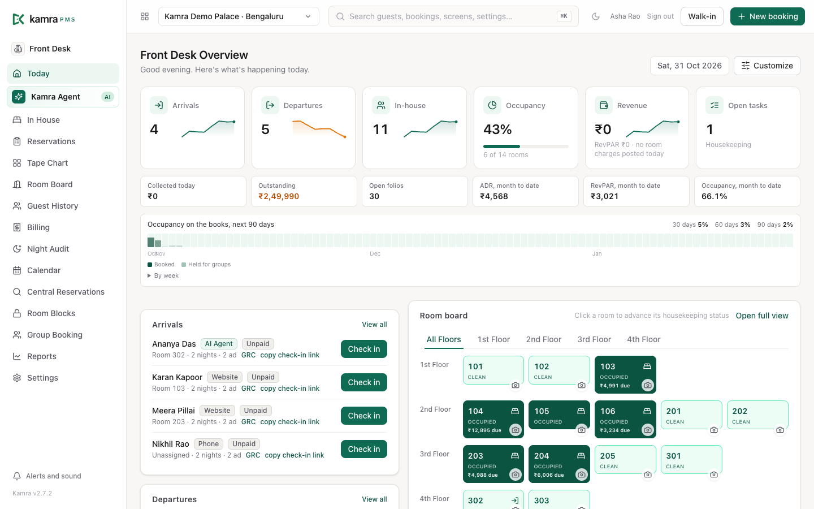
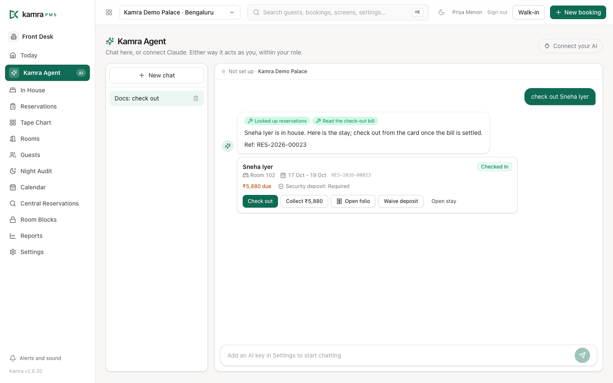

<p align="center">
  
</p>

<h1 align="center">Kamra PMS</h1>

<p align="center">
  <b>The open-source hotel PMS your staff and your AI can both run.</b><br/>
  Front desk, housekeeping, billing, F&amp;B, banquets and a booking engine for hotels, resorts and villas,<br/>
  with a governed MCP layer so Claude or ChatGPT works as a permission-checked member of staff.
</p>

<p align="center">
  <a href="https://demo.kamrapms.com"></a>
  <a href="https://github.com/Kamra-PMS/kamra-pms/releases/latest"></a>
  <a href="license.txt"></a>
  <a href="https://cloud.frappe.io/marketplace/apps/kamra"></a>
  <a href="https://kamrapms.com/docs/"></a>
  
</p>

<p align="center">
  <a href="https://demo.kamrapms.com"><b>Try the demo</b></a> ·
  <a href="https://kamrapms.com/docs/"><b>Read the docs</b></a> ·
  <a href="#install"><b>Install</b></a>
</p>

Kamra is a full property management system for hotels, resorts and short-term rentals. It runs on [Frappe](https://frappe.io) (the framework behind ERPNext), it is AGPL-3.0, and every feature is in the open-source app: no editions, no per-room fees. Current release: **v2.7.2** ([changelog](CHANGELOG.md)).

On the [demo](https://demo.kamrapms.com), tap any role to sign in. The guest booking page is at [/book](https://demo.kamrapms.com/book) and the housekeeping phone app at [/kamra/hk](https://demo.kamrapms.com/kamra/hk).



---

## What Kamra does

**Front desk**
- Today screen with arrivals, departures, in-house guests, balances due and a live room board.
- One-screen walk-ins, guided check-in with an ID card per guest, group check-in, and online self check-in by link.
- Tape chart and calendar: book from an empty cell, move rooms, extend or shorten a stay.
- Groups with a rooming list, group rate, deposit and quotation; central reservations across several properties.

**Housekeeping**
- Room Board for supervisors and a phone app (`/hk`) for floor staff: claim a room, start, finish with a photo.
- Tasks with deadlines and escalation, guest requests with an SLA report.
- Guest laundry from collection to folio, minibar posting, lost and found, shift handover.

**Billing and finance**
- Folios with a tax rate per line, split and routed billing (the company pays the room, the guest pays the bar), payment links and security deposits.
- Cashier tills, shift reports, petty cash and a currency desk; bills paid and shown in another currency.
- End of Day (night audit) wizard that checks blockers, posts the nights and saves an audit pack; it also runs by itself at 03:00.
- Accounts receivable with company accounts, statements and aging, plus accounts payable, P&amp;L and balance sheet.

**F&amp;B and banquets**
- Restaurant POS with a table map, room charges to the folio, kitchen display and network kitchen printers.
- Kitchen stock and recipes that move when an order is sent.
- Banquets from enquiry to quotation, event order (BEO), receipts and close-out, with a venue diary.

**Revenue and reports**
- Room types, rate plans, seasons, meal plans, vouchers, negotiated company rates and rate guardrails.
- Manager flash, property and portfolio dashboards (occupancy, ADR, RevPAR), budget against actual.
- Custom report builder with save and email, and report packs per department.

**Booking engine**
- Your own booking page at `/book` with live rates, add-ons, instant booking or request to book, and a booking language of its own.
- Short-term rentals: a catalogue of villas sold as rooms or the whole place, cleaning fees and refundable deposits.
- Channel manager adapters for Channex.io, STAAH and AioSell; CSV import of bookings when you switch.

**AI and MCP**
- Kamra Agent, the in-app assistant, with action cards to check in, collect or open a folio.
- 161 MCP tools for Claude, ChatGPT or any MCP client. See [Run your hotel with AI](#run-your-hotel-with-ai).

The staff UI is in English, Spanish, Arabic and Portuguese (Brazil). Module by module, with screenshots: [Features](https://kamrapms.com/docs/features).

---

## Run your hotel with AI



- **Kamra Agent** is built in and on by default. Bring your own key from OpenAI, Gemini, Groq, OpenRouter, Ollama, Azure or any OpenAI-compatible provider. No markup: requests go from your server to your provider.
- **MCP for Claude and ChatGPT.** Open **Kamra Agent → Connect your AI** and click **Connect Claude**, or add your site's `/mcp` URL as a connector in ChatGPT. Claude Code works too:

  ```bash
  claude mcp add --transport http kamra https://pms.yourhotel.com/mcp
  ```

- **One write path.** The desk, the REST API, Kamra Agent and MCP clients all call the same governed functions. Each call is checked against the person's roles and property, and every change lands in the Activity Log with who, what and why.
- **Prices always come from Kamra.** Quotes, tax, deposits and availability are computed by Kamra's pricing code. An AI can ask for a quote or post a charge; it never invents a number, and rate guardrails refuse anything outside the floor and ceiling.
- **You decide who uses it.** A hotel admin gives each person MCP Read or MCP Manage, can make a property read-only for AI, or block single tools.

Guide: [Connect your AI (MCP)](https://kamrapms.com/docs/ai-and-mcp) · [MCP tool reference](https://kamrapms.com/docs/mcp-tools) · [REST API reference](https://kamrapms.com/docs/api-reference)

Kamra is built and maintained by [HeyKoala](https://heykoala.ai) (Koala AI Solutions Pvt Ltd). HeyKoala also offers hosted AI services for hotels, such as guest calls and WhatsApp; they are separate and optional, and Kamra works fully without them.

---

## Country packs

The property's country picks its pack. The pack decides tax, invoice wording, ID types, payment modes, the privacy notice and any country-only integrations, so one country's integrations never show up in another.

| Country | Highlights |
|---|---|
| India | GST by tariff slab, CGST + SGST or IGST, GSTR-1 export, Razorpay and Cashfree payment links, Form C |
| Saudi Arabia | VAT 15%, municipality fee, ZATCA Phase 1 e-invoices with QR, Shomoos register |
| United Arab Emirates | VAT 5%, municipality fee, TRN on the tax invoice |
| Malaysia | SST on rooms and F&amp;B, tourism tax note |
| Thailand | VAT 7%, service charge as its own line |
| Indonesia | Regional hotel tax (PB1 / PBJT) |
| Brazil | ISS, BRL, CNPJ / CPF, NFS-e reference |
| Nicaragua | IVA 15%, NIO |
| Anywhere else | One flat rate from property settings |

Rates are defaults you can change per property or room type. A new country is one Python module: [Write a country pack](https://kamrapms.com/docs/write-a-country-pack).

---

## Install

| Method | Best for | Guide |
|---|---|---|
| **Frappe Cloud Marketplace** | Managed hosting, no server to run (needs a private bench) | [Install via Frappe Cloud](https://kamrapms.com/docs/self-hosting/frappe-cloud) |
| **Docker on a VPS** | Hostinger, DigitalOcean, Linode, AWS or your own box | [Quickstart](https://kamrapms.com/docs/quickstart) |
| **Bench** | Teams already running Frappe or ERPNext | [Bench install](https://kamrapms.com/docs/self-hosting/bench) |

**Docker** (2 vCPU / 4 GB minimum, three prompts: domain, admin email, admin password):

```bash
curl -fsSL https://raw.githubusercontent.com/Kamra-PMS/kamra-pms/main/deploy/install.sh | bash
```

Cheapest path in India and South-East Asia: a Hostinger KVM 2 through the [Kamra referral link](https://www.hostinger.com/in?REFERRALCODE=kamrapms) (20% off, or coupon `KAMRAPMS`; it helps keep Kamra going). [Hostinger guide](https://kamrapms.com/docs/self-hosting/hostinger).

**Bench:**

```bash
bench get-app payments
bench get-app kamra https://github.com/Kamra-PMS/kamra-pms --branch main
bench --site your-site install-app kamra
```

Then open `/kamra`, sign in as Administrator with the password you set (there is no default) and finish `/kamra/setup`. Production installs track `main`; `develop` is the nightly channel. Going live: [go-live checklist](https://kamrapms.com/docs/go-live).

Rather not run a server or set it up yourself? Frappe Cloud hosts, backs up and updates it, and our [implementation service](https://kamrapms.com/implementation/) covers migration, setup and training. Implementers can list themselves on [kamrapms.com/partners](https://kamrapms.com/partners/).

---

## Docs and help

- **Manual:** [kamrapms.com/docs](https://kamrapms.com/docs/) (guides by role, every module, self-hosting, FAQ), also in [Spanish](https://kamrapms.com/docs/es/) and [Arabic](https://kamrapms.com/docs/ar/)
- **Developers:** [REST API reference](https://kamrapms.com/docs/api-reference), [Postman collection](https://kamrapms.com/docs/kamra.postman_collection.json), [How Kamra works](https://kamrapms.com/docs/how-it-works)
- **Why Kamra, and how we fund it:** [kamrapms.com/why-kamra](https://kamrapms.com/why-kamra/) and [kamrapms.com/how-kamra-makes-money](https://kamrapms.com/how-kamra-makes-money/)
- **Bugs and ideas:** [GitHub issues](https://github.com/Kamra-PMS/kamra-pms/issues)
- **Email:** [hello@kamrapms.com](mailto:hello@kamrapms.com)

## Security

Please report vulnerabilities privately, not in a public issue. See [SECURITY.md](SECURITY.md).

## Contributing

Issues and PRs are welcome. Branch from `develop`, use [Conventional Commits](https://www.conventionalcommits.org/), and put anything country-specific in that country's pack, not the core. The full guide, including the eval checks a backend fix needs, is in [CONTRIBUTING.md](CONTRIBUTING.md).

### Quickstart (development)

```bash
bench init --frappe-branch v16.25.0 frappe-bench && cd frappe-bench
bench get-app payments
bench get-app kamra https://github.com/Kamra-PMS/kamra-pms
bench new-site kamra.localhost --admin-password admin
bench --site kamra.localhost install-app kamra
bench serve --port 8000
cd apps/kamra/frontend && npm install && npm run dev   # hot-reload UI on :5173
```

More in [docs-dev.md](docs-dev.md).

## License and trademark

The code is **AGPL-3.0**: free to use, change, host and sell. Anyone offering a modified Kamra as a hosted service must share those changes. The Kamra name and mark are covered by [TRADEMARK.md](TRADEMARK.md): run and resell Kamra freely, show your own hotel or partner logo next to ours, and give a changed fork its own name.

---

## Contributors

Every merged PR and every issue that shapes a feature is credited in the release notes and here. The full list also lives on the docs site: [Contributors](https://kamrapms.com/docs/contributors).

**Code**

- [@Kruthikagowda12](https://github.com/Kruthikagowda12): the AioSell channel-manager adapter and its fixes ([#40](https://github.com/Kamra-PMS/kamra-pms/pull/40), [#46](https://github.com/Kamra-PMS/kamra-pms/pull/46), [#52](https://github.com/Kamra-PMS/kamra-pms/pull/52)), housekeeping proof media and room swap / upgrade ([#74](https://github.com/Kamra-PMS/kamra-pms/pull/74)), phone validation ([#69](https://github.com/Kamra-PMS/kamra-pms/pull/69)), season scoping ([#80](https://github.com/Kamra-PMS/kamra-pms/pull/80)), property / booking flow work ([#22](https://github.com/Kamra-PMS/kamra-pms/pull/22)), and per-head small-group rates with weekend / weekday guardrails ([#162](https://github.com/Kamra-PMS/kamra-pms/pull/162)), and group rooming-list booking with group rate, deposit and quotation ([#422](https://github.com/Kamra-PMS/kamra-pms/pull/422))
- [@Mohammed-Muneef](https://github.com/Mohammed-Muneef): laundry, kitchen display v2, inventory & recipes, menu import, ID-document hardening
- [@faresalslahi-collab](https://github.com/faresalslahi-collab): booking guest and room summary ([#83](https://github.com/Kamra-PMS/kamra-pms/pull/83))
- [@ShaikhAmerPasha](https://github.com/ShaikhAmerPasha): saved bookings keep their voucher after it expires or hits its limit ([#142](https://github.com/Kamra-PMS/kamra-pms/issues/142), [#143](https://github.com/Kamra-PMS/kamra-pms/pull/143)), folio charges refuse zero or minus amounts and unknown tax rates ([#146](https://github.com/Kamra-PMS/kamra-pms/issues/146), [#147](https://github.com/Kamra-PMS/kamra-pms/pull/147)), and the bill screen's Void button, which now asks for a reason ([#160](https://github.com/Kamra-PMS/kamra-pms/issues/160), [#161](https://github.com/Kamra-PMS/kamra-pms/pull/161))
- [@ernestoruiz89](https://github.com/ernestoruiz89): Spanish localization and menu navigation fixes (fork [#320](https://github.com/Kamra-PMS/kamra-pms/pull/320), landed via [#324](https://github.com/Kamra-PMS/kamra-pms/pull/324), included in 2.6.21), international guest phone prefixes ([#345](https://github.com/Kamra-PMS/kamra-pms/pull/345), [#360](https://github.com/Kamra-PMS/kamra-pms/pull/360)), and the chat assistant using the property's currency ([#368](https://github.com/Kamra-PMS/kamra-pms/pull/368), 2.6.22), and the MCP OAuth discovery fix ([#387](https://github.com/Kamra-PMS/kamra-pms/pull/387), 2.7.0)
- [@SandroG1977](https://github.com/SandroG1977): Brazil country pack: ISS, BRL, CNPJ/CPF, NFS-e ([#378](https://github.com/Kamra-PMS/kamra-pms/pull/378)); Portuguese (pt-BR) staff UI ([#377](https://github.com/Kamra-PMS/kamra-pms/pull/377), landed via [#383](https://github.com/Kamra-PMS/kamra-pms/pull/383)); the Portuguese review and wording glossary ([#410](https://github.com/Kamra-PMS/kamra-pms/pull/410)); the assistant quoting with exact occupancy and tax-inclusive totals ([#432](https://github.com/Kamra-PMS/kamra-pms/pull/432)); room pricing fields and children on quote cards ([#444](https://github.com/Kamra-PMS/kamra-pms/pull/444))
- [@pmwanje2](https://github.com/pmwanje2): the hotel's own name and logo next to Kamra's ([#431](https://github.com/Kamra-PMS/kamra-pms/pull/431), landed via [#436](https://github.com/Kamra-PMS/kamra-pms/pull/436))

**Docs and guides**

- [@caseylee-TC](https://github.com/caseylee-TC): [Write a country pack](https://kamrapms.com/docs/write-a-country-pack) tutorial ([#362](https://github.com/Kamra-PMS/kamra-pms/pull/362), fixes [#258](https://github.com/Kamra-PMS/kamra-pms/issues/258))

**Hotels and users who shaped it through issues**

- [@lhertig](https://github.com/lhertig): folio payments in the property currency ([#341](https://github.com/Kamra-PMS/kamra-pms/issues/341)), `max_total_occupants` on mixed adult/child bookings ([#342](https://github.com/Kamra-PMS/kamra-pms/issues/342)), pre-arrival advance refunds releasing Deposit and reducing `advance_paid` ([#343](https://github.com/Kamra-PMS/kamra-pms/issues/343)), and concurrent booking `tabSeries` deadlock retries ([#344](https://github.com/Kamra-PMS/kamra-pms/issues/344))
- [@faresalslahi-collab](https://github.com/faresalslahi-collab) (Sarawat Park Hotel & Resort): the one-screen walk-in ([#97](https://github.com/Kamra-PMS/kamra-pms/issues/97)), which led to the Saudi Arabia pack and ZATCA, Arab-world dial codes ([#98](https://github.com/Kamra-PMS/kamra-pms/issues/98)), and Kamra's kitchen ledger clashing with ERPNext stock on a shared site ([#131](https://github.com/Kamra-PMS/kamra-pms/issues/131))
- [@atomic-glitch](https://github.com/atomic-glitch): the housekeeping Room Board and role checks ([#99](https://github.com/Kamra-PMS/kamra-pms/issues/99)), room change from the reservation and GRC ([#113](https://github.com/Kamra-PMS/kamra-pms/issues/113)), and deposits before arrival ([#114](https://github.com/Kamra-PMS/kamra-pms/issues/114))
- [@ali-qa-sudo](https://github.com/ali-qa-sudo): role-aware Walk-in / New booking buttons ([#120](https://github.com/Kamra-PMS/kamra-pms/issues/120))
- [@omar99elnemr](https://github.com/omar99elnemr): checkout refused until the bill is settled ([#132](https://github.com/Kamra-PMS/kamra-pms/issues/132))
- [@Syzygy2048](https://github.com/Syzygy2048): current OpenAI models in the assistant ([#23](https://github.com/Kamra-PMS/kamra-pms/issues/23))

**Security**

- **[@archnexus707](https://github.com/archnexus707)**: found and responsibly disclosed cross-property access ([GHSA-6cr2](https://github.com/Kamra-PMS/kamra-pms/security/advisories/GHSA-6cr2-jm8f-6jrx)), fixed in 2.6.5
- [@kta1kri](https://github.com/kta1kri): unauthenticated webhooks ([GHSA-5hcx](https://github.com/Kamra-PMS/kamra-pms/security/advisories/GHSA-5hcx-h257-qr5j)) and an independent report of GHSA-6cr2, both fixed in 2.6.5

---

*Kamra means "room". The door in our logo is open on purpose.*
