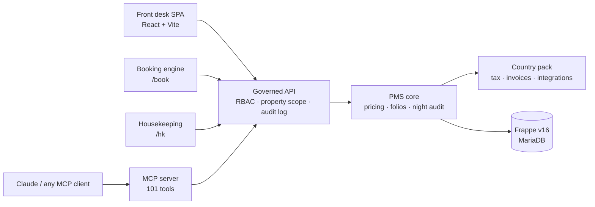

<p align="center">
  
</p>

<h1 align="center">Kamra PMS</h1>

<p align="center">
  <b>Free, open-source property management system</b> for hotels, resorts,<br/>
  villas and short-term rentals - with a <b>governed MCP layer</b> so Claude<br/>
  (or any AI agent) can actually run the property.
</p>

<p align="center">
  <a href="https://demo.kamrapms.com"></a>
  <a href="https://github.com/Kamra-PMS/kamra-pms/releases/latest"></a>
  <a href="https://github.com/Kamra-PMS/kamra-pms/stargazers"></a>
  <a href="https://github.com/Kamra-PMS/kamra-pms/network/members"></a>
  <a href="https://github.com/Kamra-PMS/kamra-pms/issues"></a>
  <a href="https://github.com/Kamra-PMS/kamra-pms/pulls"></a>
  <a href="license.txt"></a>
  <a href="https://frappecloud.com/marketplace/apps/kamra"></a>
  <a href="https://kamrapms.com/docs/"></a>
  
  
</p>

<p align="center">
  <a href="https://demo.kamrapms.com"><b>Live demo</b></a> ·
  <a href="https://kamrapms.com/docs/ai-and-mcp"><b>Connect Claude (MCP)</b></a> ·
  <a href="https://kamrapms.com/docs/mcp-tools"><b>MCP tools</b></a> ·
  <a href="https://kamrapms.com/docs/developers"><b>API · Postman</b></a> ·
  <a href="https://kamrapms.com/docs/"><b>Docs</b></a> ·
  <a href="#install"><b>Install</b></a> ·
  <a href="mailto:hello@kamrapms.com"><b>Contact</b></a>
</p>

> **Try it in 30 seconds → [demo.kamrapms.com](https://demo.kamrapms.com)**  
> Tap any role to sign in (credentials are on the page). Guest booking: [/book](https://demo.kamrapms.com/book) · Housekeeping: [/kamra/hk](https://demo.kamrapms.com/kamra/hk)

**Kamra** is a free **open-source hotel PMS** (property management system) for
hotels, resorts, boutiques, villas and **Airbnb-style short-term rentals**
anywhere in the world. It runs on **Frappe v16** (the stack behind ERPNext),
is licensed **AGPL-3.0**, and is built so **humans and AI agents share one
governed write path** - booking, check-in, folios, night audit, pricing -
with **deterministic money** (never invented by an LLM).

No per-room rent. No feature gates. Self-host on a ₹549 / $24 VPS, or install
from the [Frappe Cloud Marketplace](https://frappecloud.com/marketplace/apps/kamra).

---

## Why teams pick Kamra

| Looking for… | Kamra |
|---|---|
| **Free open-source PMS** | AGPL-3.0, every feature included |
| **Self-hosted hotel software** | Docker one-liner, bench, or Frappe Cloud |
| **AI that can run the desk** | Hosted **MCP** at `/mcp` - Claude books as a staff user |
| **GST / VAT / ZATCA** | Country packs (India, Saudi, UAE, MY, TH, ID, …) |
| **STR / villa PMS** | Whole-place units, cleaning fees, deposits, `/book` catalogue |
| **No vendor lock-in** | Your server, your data, export anytime |

### The product edge: governed MCP

Most hotel software bolts a chatbot onto a closed SaaS. **Kamra ships a real
MCP server** over the hotel's own APIs:

1. Connect Claude → **Kamra Agent → Connect your AI**
2. Allow the OAuth grant for a property
3. Ask in hotel language: *"Book Mr. Rao a deluxe Fri-Sun with breakfast"*

Tools are **role-scoped**, **module-gated**, and **fully audited**. Prices,
taxes and availability stay in code (`pricing.py`, folio ledger). The model
never invents a rate.

| Doc | Link |
|---|---|
| Connect Claude (MCP setup) | https://kamrapms.com/docs/ai-and-mcp |
| MCP tool reference (101 tools) | https://kamrapms.com/docs/mcp-tools |
| How Kamra works (architecture) | https://kamrapms.com/docs/how-it-works |
| API · MCP · Postman shortcuts | https://kamrapms.com/docs/developers |
| REST API reference | https://kamrapms.com/docs/api-reference |
| Postman collection (download) | https://kamrapms.com/docs/kamra.postman_collection.json |
| Full manual | https://kamrapms.com/docs/ |
| What's new (v2.6.16) | https://kamrapms.com/docs/releases |

```bash
# Claude Code - same OAuth tools as Desktop
claude mcp add --transport http kamra https://pms.yourhotel.com/mcp
```

Air-gapped? Use the stdio sidecar [`mcp/kamra_mcp.py`](mcp/kamra_mcp.py).

---

## Contents

- [Why teams pick Kamra](#why-teams-pick-kamra)
- [What's new](#whats-new)
- [What makes it different](#what-makes-it-different)
- [Screenshots](#screenshots)
- [Short-term rentals](#short-term-rentals)
- [Features](#features)
- [Countries](#countries)
- [How it's built](#how-its-built)
- [Documentation, MCP & API](#documentation-mcp--api)
- [Install](#install)
- [Quickstart (development)](#quickstart-development)
- [Contributing](#contributing)
- [Who it's for](#who-its-for)
- [License & contributors](#license--contributors)

---

## What's new

Latest release: **[v2.6.16](https://github.com/Kamra-PMS/kamra-pms/releases/latest)**
(`develop` ships nightly). On the
[Frappe Cloud Marketplace](https://frappecloud.com/marketplace/apps/kamra)
and documented at [kamrapms.com/docs/releases](https://kamrapms.com/docs/releases).

- **2.6.16** - pet charge on booking pages, desk and folio; extra guests
  above capacity billed as their own folio line
- **2.6.15** - End of Day night-audit checklist with a saved report pack and a
  Night Auditor role; corporate guests settle their own extras; POS bills
  can't close unpaid; advance deposits clear at check-in
- **2.6.14** - Request-to-Book inbox, per-property no-show policy, rate lock
  at booking, security deposits, day use, printable QR codes, city-ledger
  payments, a complete ledger, and a lighter first page load
- **2.6.13** - settings hub, tiered cancellation and peak-date rules, POS
  auto-KOT; night audit can't run ahead of the calendar; whole-villa
  check-in; Kamra Agent books by room and meal-plan name without
  double-booking on retries
- **2.6.9 – 2.6.12** - India pack (Razorpay, Cashfree, GSTR-1, Kamra Verify);
  privacy notices in seven Indian languages; rate guardrails; marketplace
  packaging for Frappe Cloud
- **2.6.5 – 2.6.8** - property-scope security, signed webhooks, deposits
  before arrival, ERPNext Company and stock alongside Kamra

Full notes: [`CHANGELOG.md`](CHANGELOG.md) · how we ship: [`RELEASING.md`](RELEASING.md).

---

## What makes it different

- **Agent-ready, not agent-locked.** [MCP server](https://kamrapms.com/docs/ai-and-mcp)
  with **101** governed tools - role-scoped, module-gated, permission-checked,
  fully logged. Connect Claude; no bundled agent to trust.
- **Bring your own key.** No AI markup or model lock-in. Optional
  [HeyKoala](https://heykoala.ai) for voice / WhatsApp concierge.
- **Deterministic money.** Rates, tax slabs, availability, and no-overbooking
  guards come from code - never from a language model.
- **Full audit trail.** Every human or AI action: who, what, why.
- **Privacy by design.** DPDP / GDPR-friendly defaults: ID verify-and-discard,
  erasure and access export, retention, children's data kept to name and age,
  guest contacts kept out of AI prompts.
- **Country packs.** Tax, invoices, ID types, payment gateways and statutory
  reports per country - India's Razorpay never reaches a Saudi hotel, which
  gets ZATCA instead.
- **Built on Frappe.** RBAC, multi-tenancy, Desk escape hatch, ERPNext-adjacent
  ecosystem (Company and stock work alongside Kamra).

---

## Screenshots

*From the [live demo](https://demo.kamrapms.com) - open it and click around.*

| | |
|---|---|
|  |  |
| **Today** - arrivals, departures, in-house, paid/due chips, room board | **Reservation 360** - billing, amend dates, check-in / out / cancel |
|  |  |
| **Tape chart** - rooms × dates, moves & stay amendments | **Reports** - occupancy, ADR, RevPAR, flash |
|  |  |
| **New booking** - live quote, multi-room, add-ons, cancellation policy | **Guest profile** - stay strip, merge & anonymize (DPDP) |
|  |  |
| **Folio & tax invoice** - per-line GST, splits, payment links | **Booking engine console** - gallery, policies, FAQ, SEO |
|  |  |
| **Restaurant POS** - table map, KOT / bill print, F-keys | **Dashboard** - occupancy, revenue, chain roll-up |
|  |  |
| **Laundry** - pickup → return → folio; guest self-service | **Self check-in** - ID capture, e-sign, retention policy |

**Guest-facing booking page** - date range, **Check availability**, rates, gallery, policies, pay-at-hotel:

[](https://demo.kamrapms.com/book)

---

## Short-term rentals

Same PMS for **villas and multi-site STR portfolios**: sellable units
(room / whole-place / package), competition groups, cleaning fees, security
deposits (collect / withhold / refund), Instant or Request-to-book, and a
catalog that feels like a listing site.

| | |
|---|---|
|  |  |
| **Catalog** - check-in / out + Check availability | **Places to stay** - per-villa cards & from-rates |

[](https://demo.kamrapms.com/book)

Live example: [demo.kamrapms.com/book](https://demo.kamrapms.com/book).

---

## Features

| Area | What you get |
|---|---|
| **Front desk** | Today board, Request-to-Book inbox, check-in flow (GRC readiness + room suggestion), tape chart, ETA/ETD, guest profiles, blacklist with logged override, per-property no-show policy |
| **Booking engine** | Direct booking + SEO console; hotels = room grid; STRs = villa catalog |
| **Short-term rentals** | Hotel vs STR property kind, sellable units, per-villa locations, whole-villa check-in, security deposits, Instant / Request-to-book |
| **Booking** | Multi-room / group / corporate, returning guests, add-ons, vouchers, travel agents, day-use, rate lock at booking |
| **Revenue** | Seasons, rate plans, guardrails, hurdle rates, overbooking allowance, cancellation & no-show policy in code |
| **Billing** | Folios, corporate routing, group masters, charge splits, deposits, End of Day (night audit + report pack), city-ledger, tax invoices, cashier till, folio ledger; India: Razorpay / Cashfree / GSTR-1 |
| **F&B** | POS table map, kitchen pass, split bills, thermal KOT, kitchen display, inventory & recipes, QR ordering, room posting, optional auto-KOT |
| **Operations** | Tickets + SLA, housekeeping `/hk`, guest laundry, lost & found, banquets / events |
| **Guests** | Online pre-check-in, GRC + occupant register, ID retention modes, Kamra Verify (India) |
| **Privacy** | Erasure, access export, retention, AI-prompt redaction, notices in English, Arabic and seven Indian languages |
| **Messaging** | WhatsApp (Meta Cloud API) - confirmations, check-in links, inbox |
| **Localization** | Six country packs plus a flat-tax fallback; English / العربية UI |
| **Platform** | Multi-property RBAC, dark mode, System Health, CSV migration (eZee / Cloudbeds), eval harness in CI |
| **Agents** | Hosted MCP `/mcp`, stdio sidecar, in-app Kamra Agent (BYO key), Activity Log |

---

## Countries

The property's country picks its pack. The pack decides tax, invoice wording,
ID types, payment modes, the privacy notice and any country-only
integrations. One country's integrations are never offered in another.

| Country | Tax on rooms and F&B | Invoices and filings | Front desk and integrations |
|---|---|---|---|
| 🇮🇳 India | GST slab by nightly tariff (5% / 18% around ₹7,500) or fixed; F&B 5% | CGST + SGST or IGST from the GSTIN, SAC per line, GSTR-1 export | Aadhaar, PAN, Voter ID; UPI; Razorpay and Cashfree; Kamra Verify; Form C; notice in 7 Indian languages |
| 🇸🇦 Saudi Arabia | VAT 15%; municipality fee as a room levy | ZATCA Phase 1: UUID, hash chain, UBL 2.1 XML and QR | National ID, Iqama, GCC ID; Shomoos; Arabic UI |
| 🇦🇪 UAE | VAT 5%; municipality fee as a room levy | TRN on "Tax Invoice" | Emirates ID, GCC ID |
| 🇲🇾 Malaysia | SST 8% on rooms, 6% on F&B | Tourism Tax note for foreign guests | MyKad |
| 🇹🇭 Thailand | VAT 7% | 13-digit Tax ID; service charge as its own line | Thai ID card |
| 🇮🇩 Indonesia | Regional hotel tax (PB1 / PBJT) 10% by default | | KTP, KITAS |
| Anywhere else | One flat rate from property settings | Plain tax invoice | Passport, national ID |

A new country is one Python module behind the `kamra_localization` hook; see
[Country packs](CONTRIBUTING.md#country-packs).

---

## How it's built



- **One API for everyone.** UI, booking engine, housekeeping app and AI
  agents call the same whitelisted methods. Each call checks role and
  property; every change is logged.
- **Money is code.** Quotes, tax, deposits and availability use `Decimal`.
  An agent can ask for a quote or post a charge, but never invents a number.
- **Evals in CI.** `kamra/scripts/eval_harness.py` runs real hotel flows on
  a fresh site for every PR, alongside Semgrep, CodeQL and a fresh-install
  check.

| Path | What lives there |
|---|---|
| `kamra/` | Frappe app: doctypes, APIs, folio, pricing, cashier, POS, HK, banquets, privacy |
| `kamra/localization/` | Country packs (`india/`, `saudi.py`, `uae.py`, …) |
| `kamra/mcp_tools.py`, `mcp/` | MCP registry + hosted `/mcp` + stdio server |
| `frontend/` | React SPA (build committed to `kamra/public/frontend`) |
| `docs-site/` | [kamrapms.com/docs](https://kamrapms.com/docs/) (versioned) |
| `deploy/` | Self-host installer |

---

## Documentation, MCP & API

**Manual (versioned):** [kamrapms.com/docs](https://kamrapms.com/docs/) ·
frozen snapshots at `/docs/vX.Y.Z/` from each GitHub Release.

| I want to… | Go here |
|---|---|
| Understand the system | [How Kamra works](https://kamrapms.com/docs/how-it-works) |
| Connect Claude / MCP | [Connect your AI](https://kamrapms.com/docs/ai-and-mcp) |
| Browse every MCP tool | [MCP tool reference](https://kamrapms.com/docs/mcp-tools) |
| Call REST from my stack | [REST API basics](https://kamrapms.com/docs/api) · [API reference](https://kamrapms.com/docs/api-reference) |
| Import Postman / Insomnia | [Postman collection ↓](https://kamrapms.com/docs/kamra.postman_collection.json) |
| All developer shortcuts | [API · MCP · Postman hub](https://kamrapms.com/docs/developers) |
| See features / release notes | [Features](https://kamrapms.com/docs/features) · [What's new](https://kamrapms.com/docs/releases) |
| Go live | [Go-live checklist](https://kamrapms.com/docs/go-live) |
| Self-host / Frappe Cloud | [Self-hosting](https://kamrapms.com/docs/self-hosting/) · [Frappe Cloud](https://kamrapms.com/docs/self-hosting/frappe-cloud) |

```bash
curl -X POST https://<your-kamra>/api/method/kamra.api.get_quote \
  -H "Authorization: token <api_key>:<api_secret>" \
  -H "Content-Type: application/json" \
  -d '{"property":"Your Property","room_type":"Your Property-DLX",
       "check_in_date":"2026-08-01","check_out_date":"2026-08-03"}'
```

In-repo: [`docs/marketplace-listing.md`](docs/marketplace-listing.md) ·
[`docs-dev.md`](docs-dev.md) · [`branding/`](branding/README.md) ·
[`SECURITY.md`](SECURITY.md)

---

## Install

| Method | For | How |
|---|---|---|
| **Hostinger VPS** | Cheapest self-host (India / SEA) | [Guide](https://kamrapms.com/docs/self-hosting/hostinger) + Docker one-liner |
| **Docker on any VPS** | DigitalOcean, Linode, AWS, your box | One-liner below · [quickstart](https://kamrapms.com/docs/quickstart) |
| **Bench** | Existing Frappe / ERPNext benches | Commands below · [guide](https://kamrapms.com/docs/self-hosting/bench) |
| **Frappe Cloud Marketplace** | Managed Frappe hosting | [Install Kamra](https://frappecloud.com/marketplace/apps/kamra) |

**Docker:**

```bash
curl -fsSL https://raw.githubusercontent.com/Kamra-PMS/kamra-pms/main/deploy/install.sh | bash
```

Three prompts: site domain, admin email, admin password. Then open
`/kamra/setup`. Details: [deploy/](deploy/).

**Bench / Frappe Cloud:**

```bash
bench get-app payments
bench get-app kamra https://github.com/Kamra-PMS/kamra-pms --branch main
bench --site your-site install-app kamra
```

After install: **`/kamra`** (product UI), **`/book`** (guest booking),
**`/hk`** (housekeeping). Sign in as **Administrator**, open `/kamra/setup`.

| Channel | Branch / tag | Use for |
|---|---|---|
| **Stable** | `main` / `vX.Y.Z` | Production, Marketplace, [demo](https://demo.kamrapms.com) |
| **Nightly** | `develop` | Previews (nightly.kamrapms.com) |

---

## Quickstart (development)

```bash
bench init --frappe-branch v16.25.0 frappe-bench && cd frappe-bench
bench get-app payments
bench get-app kamra https://github.com/Kamra-PMS/kamra-pms
bench new-site kamra.localhost --admin-password admin
bench --site kamra.localhost install-app kamra
bench serve --port 8000
cd apps/kamra/frontend && npm install && npm run dev   # UI on :5173
```

Seed demo data: `bench --site … execute kamra.scripts.seed_demo.execute`.
More: [docs-dev.md](docs-dev.md).

```bash
claude mcp add --transport http kamra https://pms.yourhotel.com/mcp
```

---

## Contributing

PRs and issues welcome - see [CONTRIBUTING.md](CONTRIBUTING.md).

- Branch from **`develop`**, PR against `develop`.
- [Conventional Commits](https://www.conventionalcommits.org/) (`fix:`, `feat:`, `docs:`).
- UI changes: `npm run build` and commit `kamra/public/frontend`.
- Python: run the eval harness and add a check for the behaviour you changed.

```bash
bench --site kamra.localhost console
>>> from kamra.scripts.eval_harness import execute; execute()
```

---

## Who it's for

- **Hotel / villa operators** worldwide - own the software and the data;
  costs don't grow with room count; AI is optional, not a ransom.
- **IT & integrators** - Python (Frappe) + React, documented REST + MCP,
  RBAC, audit trails, CI evals. Fork and extend.
- **Builders of hospitality AI** - a real PMS tool surface, not a demo
  chatbot API.

Searching for: *free open source PMS*, *open source hotel software*,
*self-hosted property management system*, *Frappe hotel PMS*, *MCP hotel
API*, *villa / STR PMS*, *AGPL hospitality* - this repo is that.

---

## License & contributors

**AGPL-3.0** - free forever. Anyone offering Kamra as a hosted service must
share modifications back. See [`license.txt`](license.txt).

Full credits: [Contributors](https://kamrapms.com/docs/contributors).

**Code**

- [@Kruthikagowda12](https://github.com/Kruthikagowda12): channel-manager adapter, housekeeping, rates / guardrails, booking flow
- [@Mohammed-Muneef](https://github.com/Mohammed-Muneef): laundry, kitchen display, inventory & recipes, ID hardening
- [@faresalslahi-collab](https://github.com/faresalslahi-collab): booking guest / room summary
- [@ShaikhAmerPasha](https://github.com/ShaikhAmerPasha): voucher retention, folio charge validation, Void reason

**Hotels and users who shaped it through issues**

- [@faresalslahi-collab](https://github.com/faresalslahi-collab) (Sarawat Park): one-screen walk-in, Saudi pack / ZATCA, ERPNext stock coexistence
- [@atomic-glitch](https://github.com/atomic-glitch): housekeeping board, room change, deposits before arrival
- [@ali-qa-sudo](https://github.com/ali-qa-sudo), [@omar99elnemr](https://github.com/omar99elnemr), [@Syzygy2048](https://github.com/Syzygy2048)

**Security**

- [@archnexus707](https://github.com/archnexus707): cross-property access ([GHSA-6cr2](https://github.com/Kamra-PMS/kamra-pms/security/advisories/GHSA-6cr2-jm8f-6jrx)), fixed in 2.6.5
- [@kta1kri](https://github.com/kta1kri): unauthenticated webhooks ([GHSA-5hcx](https://github.com/Kamra-PMS/kamra-pms/security/advisories/GHSA-5hcx-h257-qr5j)), fixed in 2.6.5

### Links

| | |
|---|---|
| Demo | https://demo.kamrapms.com |
| Docs | https://kamrapms.com/docs/ |
| Connect MCP | https://kamrapms.com/docs/ai-and-mcp |
| MCP tools | https://kamrapms.com/docs/mcp-tools |
| API · Postman | https://kamrapms.com/docs/developers |
| Marketplace | https://frappecloud.com/marketplace/apps/kamra |
| Website | https://kamrapms.com |
| Issues | https://github.com/Kamra-PMS/kamra-pms/issues |
| Security | [`SECURITY.md`](SECURITY.md) |
| Email | [hello@kamrapms.com](mailto:hello@kamrapms.com) |

Built by [HeyKoala](https://heykoala.ai).

---

*Kamra means "room". The door in our logo is open on purpose.*
