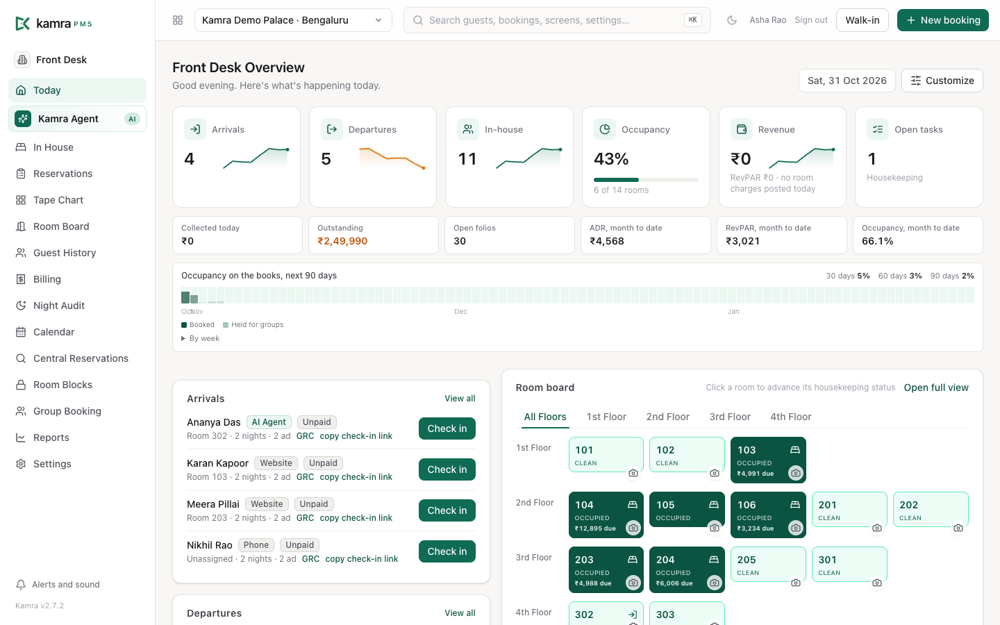
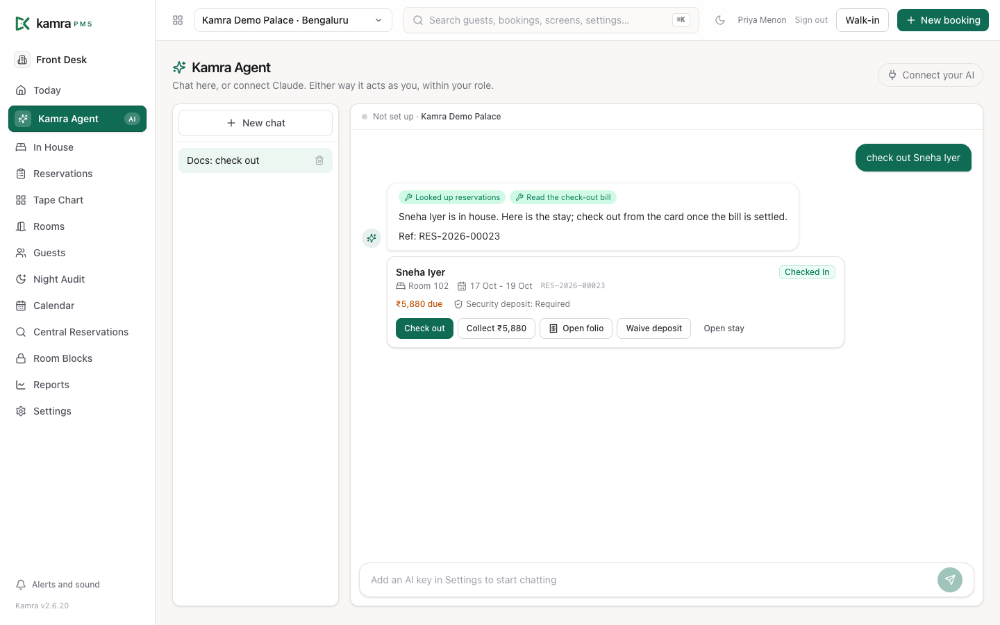

<p align="center">
  <a href="README.md">English</a> · <b>简体中文</b>
</p>

<p align="center">
  
</p>

<h1 align="center">Kamra PMS</h1>

<p align="center">
  <b>全球首个开源、可直接对接 AI 智能体的 PMS。</b><br/>
  一款员工和你的 AI 都能上手的酒店 PMS。<br/>
  面向酒店、度假村与别墅的前厅、客房、账务、餐饮、宴会和预订引擎，<br/>
  并内置受治理的 MCP 层，让 Claude 或 ChatGPT 像一名通过权限校验的员工那样工作。
</p>

<p align="center">
  <a href="https://demo.kamrapms.com"></a>
  <a href="https://github.com/Kamra-PMS/kamra-pms/releases/latest"></a>
  <a href="license.txt"></a>
  <a href="https://cloud.frappe.io/marketplace/apps/kamra"></a>
  <a href="https://kamrapms.com/docs/"></a>
  
</p>

<p align="center">
  <a href="https://demo.kamrapms.com"><b>试用演示</b></a> ·
  <a href="https://kamrapms.com/docs/"><b>阅读文档</b></a> ·
  <a href="#install"><b>安装</b></a>
</p>

**为什么说"首个"：** [Kamra 1.0](https://github.com/Kamra-PMS/kamra-pms/releases/tag/v1.0.0) 于 2026 年 7 月 5 日发布，同时满足开源、免费、由 MCP 驱动这三点。我们不知道有哪个开源 PMS 更早地把这三件事同时做到。如果 Kamra 对你有用，欢迎[给仓库点个星](https://github.com/Kamra-PMS/kamra-pms/stargazers)，让更多酒店经营者和开发者看到它。

Kamra 是面向酒店、度假村和短租业务的完整物业管理系统（PMS）。它运行在 [Frappe](https://frappe.io)（ERPNext 背后的框架）之上，采用 AGPL-3.0 许可，所有功能都在这个开源应用中：没有版本分级，也没有按房间数收费。当前版本：**v2.7.6**（[更新日志](CHANGELOG.md)）。

在[演示环境](https://demo.kamrapms.com)里，点任意角色即可登录。客人预订页在 [/book](https://demo.kamrapms.com/book)，客房清洁手机端在 [/kamra/hk](https://demo.kamrapms.com/kamra/hk)。



---

## Kamra 能做什么

**前厅**
- "今日"页面：到店、离店、在住客人、应收余额和实时房态板。
- 单屏散客入住、带每位客人证件引导式办理入住、团队入住，以及通过链接的线上自助入住。
- 时间轴图（tape chart）和日历：从空单元格直接预订、换房、延长或缩短住宿。
- 团队管理：分房单、团队价、押金和报价单；跨多个物业的中央预订。

**客房清洁**
- 面向主管的房态板，以及面向楼层员工的手机应用（`/hk`）：认领房间、开始、拍照完成。
- 带截止时间和升级机制的任务，以及带 SLA 报表的客人需求。
- 客人洗衣（从收取到入账）、迷你吧入账、失物招领、交接班。

**账务与财务**
- 账单（folio）支持逐行税率、拆分与分账（公司付房费、客人付酒吧消费）、支付链接和押金。
- 收银台、班次报表、备用金和货币兑换台；账单可用另一种货币支付并显示金额。
- 日结（夜审）向导：检查阻碍项、过夜租、生成审计包；也会在 03:00 自动运行。
- 应收账款（公司账户、对账单与账龄），以及应付账款、损益表和资产负债表。

**餐饮与宴会**
- 餐厅 POS：桌位图、房账挂账到 folio、厨房显示系统和局域网厨房打印机。
- 厨房库存与配方，在订单送出时同步扣减。
- 宴会从询价到报价、活动执行单（BEO）、收款与结项，并配场地日程表。

**收益与报表**
- 房型、价格方案、季节、餐食计划、券、协议公司价和价格护栏。
- 经理速报、单店与组合仪表盘（出租率、ADR、RevPAR），预算与实际对比。
- 自定义报表生成器（保存与邮件发送），以及按部门划分的报表包。

**预订引擎**
- 你自己的预订页 `/book`：实时房价、附加产品、即时确认或请求预订，以及独立的预订页语言。
- 短租：别墅目录，可按房间或整栋出售，含清洁费和可退押金。
- 渠道管理器适配器：Channex.io、STAAH、AioSell；迁移时可 CSV 导入订单。

**AI 与 MCP**
- Kamra Agent 内置助手，带操作卡片，可办理入住、收款或打开 folio。
- 面向 Claude、ChatGPT 或任何 MCP 客户端的 161 个 MCP 工具。见[用 AI 经营你的酒店](#run-your-hotel-with-ai)。

员工端界面支持英语、西班牙语、阿拉伯语和葡萄牙语（巴西）。按模块查看带截图的说明：[功能](https://kamrapms.com/docs/features)。

---

## <a name="run-your-hotel-with-ai"></a>用 AI 经营你的酒店



- **Kamra Agent** 内置并默认开启。可自带 OpenAI、Gemini、Groq、OpenRouter、Ollama、Azure 或任何兼容 OpenAI 的提供商密钥。不加价：请求直接从你的服务器发往你的提供商。
- **面向 Claude 和 ChatGPT 的 MCP。** 打开 **Kamra Agent → 连接你的 AI**，点击 **连接 Claude**，或者把你站点的 `/mcp` 地址添加为 ChatGPT 的连接器。Claude Code 同样可用：

  ```bash
  claude mcp add --transport http kamra https://pms.yourhotel.com/mcp
  ```

- **同一条写入路径。** 前台界面、REST API、Kamra Agent 和 MCP 客户端调用的都是同一批受治理函数。每次调用都会核对操作者的角色和物业范围，每项变更都会记入活动日志，包含谁、做了什么、为什么。
- **价格永远来自 Kamra。** 报价、税费、押金和可用房量都由 Kamra 的定价代码计算。AI 可以询价或挂账，但绝不会自己编一个数字，价格护栏会拒绝任何超出下限与上限的报价。
- **由你决定谁能用。** 酒店管理员可以给每个人分配 MCP 只读或 MCP 管理权限，可以把某个物业设为对 AI 只读，也可以单独禁用某些工具。

指南：[连接你的 AI（MCP）](https://kamrapms.com/docs/ai-and-mcp) · [MCP 工具参考](https://kamrapms.com/docs/mcp-tools) · [REST API 参考](https://kamrapms.com/docs/api-reference)

Kamra 由 [HeyKoala](https://heykoala.ai)（Koala AI Solutions Pvt Ltd）构建与维护。HeyKoala 也为酒店提供托管式 AI 服务，例如客人来电和 WhatsApp；这些服务相互独立且可选，没有它们 Kamra 也能完整运行。

---

## 国家包（Country packs）

物业所在国家决定使用哪个包。该包决定税率、发票措辞、证件类型、支付方式、隐私声明以及仅限该国使用的集成，因此一个国家的集成绝不会出现在另一个国家。

| 国家/地区 | 要点 |
|---|---|
| 印度 | 按房价档位征收 GST，CGST + SGST 或 IGST，GSTR-1 导出，Razorpay 和 Cashfree 支付链接，Form C |
| 沙特阿拉伯 | VAT 15%、市政费、带二维码的 ZATCA 第一阶段电子发票、Shomoos 登记 |
| 阿联酋 | VAT 5%、市政费、税务发票上标注 TRN |
| 马来西亚 | 客房与餐饮 SST，旅游税说明 |
| 泰国 | VAT 7%，服务费单独列示 |
| 印度尼西亚 | 地方酒店税（PB1 / PBJT） |
| 巴西 | ISS、BRL、CNPJ / CPF、NFS-e 参考号 |
| 尼加拉瓜 | IVA 15%、NIO |
| 其他国家/地区 | 使用物业设置中的单一税率 |

这些费率都是默认值，可按物业或房型修改。新增一个国家只需写一个 Python 模块：[编写国家包](https://kamrapms.com/docs/write-a-country-pack)。

---

## <a name="install"></a>安装

| 方式 | 适合谁 | 指南 |
|---|---|---|
| **Frappe Cloud Marketplace** | 托管部署，无需自管服务器（需要一个私有 bench） | [通过 Frappe Cloud 安装](https://kamrapms.com/docs/self-hosting/frappe-cloud) |
| **VPS 上的 Docker** | Hostinger、DigitalOcean、Linode、AWS 或你自己的机器 | [快速开始](https://kamrapms.com/docs/quickstart) |
| **Bench** | 已经在跑 Frappe 或 ERPNext 的团队 | [Bench 安装](https://kamrapms.com/docs/self-hosting/bench) |

**Docker**（最低 2 vCPU / 4 GB，三个提示：域名、管理员邮箱、管理员密码）：

```bash
curl -fsSL https://raw.githubusercontent.com/Kamra-PMS/kamra-pms/main/deploy/install.sh | bash
```

在印度和东南亚最便宜的方案：通过 [Kamra 推荐链接](https://www.hostinger.com/in?REFERRALCODE=kamrapms) 购买 Hostinger KVM 2（八折，或使用优惠码 `KAMRAPMS`；这也有助于 Kamra 持续发展）。[Hostinger 指南](https://kamrapms.com/docs/self-hosting/hostinger)。

**Bench：**

```bash
bench get-app payments
bench get-app kamra https://github.com/Kamra-PMS/kamra-pms --branch main
bench --site your-site install-app kamra
```

然后打开 `/kamra`，用你设置的密码以 Administrator 登录（没有默认密码），并完成 `/kamra/setup`。生产安装跟踪 `main` 分支；`develop` 是每夜构建通道。上线准备：[上线检查清单](https://kamrapms.com/docs/go-live)。

不想自己跑服务器或动手安装？Frappe Cloud 负责托管、备份和升级，我们的[实施服务](https://kamrapms.com/implementation/)覆盖数据迁移、部署和培训。实施伙伴可在 [kamrapms.com/partners](https://kamrapms.com/partners/) 上登记。

---

## 文档与帮助

- **手册：**[kamrapms.com/docs](https://kamrapms.com/docs/)（按角色的指南、各模块说明、自托管、常见问题），另有[西班牙语](https://kamrapms.com/docs/es/)和[阿拉伯语](https://kamrapms.com/docs/ar/)版本
- **开发者：**[REST API 参考](https://kamrapms.com/docs/api-reference)、[Postman 集合](https://kamrapms.com/docs/kamra.postman_collection.json)、[Kamra 工作原理](https://kamrapms.com/docs/how-it-works)
- **为什么做 Kamra，以及我们如何获得资金：**[kamrapms.com/why-kamra](https://kamrapms.com/why-kamra/) 和 [kamrapms.com/how-kamra-makes-money](https://kamrapms.com/how-kamra-makes-money/)
- **缺陷与想法：**[GitHub issues](https://github.com/Kamra-PMS/kamra-pms/issues)
- **邮件：**[hello@kamrapms.com](mailto:hello@kamrapms.com)

## 安全

请私下报告漏洞，不要提交公开 issue。见 [SECURITY.md](SECURITY.md)。

## 参与贡献

欢迎提交 issue 和 PR。请从 `develop` 分支开出你的分支，使用 [Conventional Commits](https://www.conventionalcommits.org/)，并把任何国家特定的内容放进对应国家的包，而不是核心代码。完整指南（包括后端修复所需的 eval 检查）见 [CONTRIBUTING.md](CONTRIBUTING.md)。

### 快速开始（开发）

```bash
bench init --frappe-branch v16.25.0 frappe-bench && cd frappe-bench
bench get-app payments
bench get-app kamra https://github.com/Kamra-PMS/kamra-pms
bench new-site kamra.localhost --admin-password admin
bench --site kamra.localhost install-app kamra
bench serve --port 8000
cd apps/kamra/frontend && npm install && npm run dev   # 界面热重载在 :5173
```

更多内容见 [docs-dev.md](docs-dev.md)。

## 许可与商标

代码为 **AGPL-3.0**：可自由使用、修改、托管和销售。任何人若把修改后的 Kamra 作为托管服务提供，必须公开这些修改。Kamra 的名称与标志受 [TRADEMARK.md](TRADEMARK.md) 保护：可自由运行和转售 Kamra，可在我们的标志旁展示你自己的酒店或合作伙伴标志，但修改过的分支需使用自己的名称。

---

## 贡献者

每一个被合并的 PR、每一个塑造了某项功能的 issue，都会在发布说明和这里署名。完整名单也在文档站点上：[贡献者](https://kamrapms.com/docs/contributors)。

**代码**

- [@Kruthikagowda12](https://github.com/Kruthikagowda12)：AioSell 渠道管理器适配器及其修复（[#40](https://github.com/Kamra-PMS/kamra-pms/pull/40)、[#46](https://github.com/Kamra-PMS/kamra-pms/pull/46)、[#52](https://github.com/Kamra-PMS/kamra-pms/pull/52)），客房清洁凭证媒体与换房/升级（[#74](https://github.com/Kamra-PMS/kamra-pms/pull/74)），电话校验（[#69](https://github.com/Kamra-PMS/kamra-pms/pull/69)），季节范围限定（[#80](https://github.com/Kamra-PMS/kamra-pms/pull/80)），物业/预订流程相关工作（[#22](https://github.com/Kamra-PMS/kamra-pms/pull/22)），带周末/工作日护栏的按人数小团价（[#162](https://github.com/Kamra-PMS/kamra-pms/pull/162)），以及含团队价、押金和报价单的团队分房单预订（[#422](https://github.com/Kamra-PMS/kamra-pms/pull/422)）
- [@Mohammed-Muneef](https://github.com/Mohammed-Muneef)：洗衣、厨房显示系统 v2、库存与配方、菜单导入、证件文书加固
- [@faresalslahi-collab](https://github.com/faresalslahi-collab)：预订客人及房间汇总（[#83](https://github.com/Kamra-PMS/kamra-pms/pull/83)）
- [@ShaikhAmerPasha](https://github.com/ShaikhAmerPasha)：已保存的预订在券过期或达到使用上限后仍保留该券（[#142](https://github.com/Kamra-PMS/kamra-pms/issues/142)、[#143](https://github.com/Kamra-PMS/kamra-pms/pull/143)），folio 入账拒绝零值、负值与未知税率（[#146](https://github.com/Kamra-PMS/kamra-pms/issues/146)、[#147](https://github.com/Kamra-PMS/kamra-pms/pull/147)），以及账单页面的"作废"按钮现在会要求填写原因（[#160](https://github.com/Kamra-PMS/kamra-pms/issues/160)、[#161](https://github.com/Kamra-PMS/kamra-pms/pull/161)）
- [@ernestoruiz89](https://github.com/ernestoruiz89)：西班牙语本地化与菜单导航修复（fork [#320](https://github.com/Kamra-PMS/kamra-pms/pull/320)，经 [#324](https://github.com/Kamra-PMS/kamra-pms/pull/324) 合入，包含在 2.6.21 中），国际客人电话前缀（[#345](https://github.com/Kamra-PMS/kamra-pms/pull/345)、[#360](https://github.com/Kamra-PMS/kamra-pms/pull/360)），聊天助手使用物业所用货币（[#368](https://github.com/Kamra-PMS/kamra-pms/pull/368)，2.6.22），以及 MCP OAuth 发现修复（[#387](https://github.com/Kamra-PMS/kamra-pms/pull/387)，2.7.0）
- [@SandroG1977](https://github.com/SandroG1977)：巴西国家包：ISS、BRL、CNPJ/CPF、NFS-e（[#378](https://github.com/Kamra-PMS/kamra-pms/pull/378)）；葡萄牙语（pt-BR）员工端界面（[#377](https://github.com/Kamra-PMS/kamra-pms/pull/377)，经 [#383](https://github.com/Kamra-PMS/kamra-pms/pull/383) 合入）；葡萄牙语审校与措辞术语表（[#410](https://github.com/Kamra-PMS/kamra-pms/pull/410)）；助手按准确入住人数与含税总额报价（[#432](https://github.com/Kamra-PMS/kamra-pms/pull/432)）；报价卡片上的房间计价字段与儿童信息（[#444](https://github.com/Kamra-PMS/kamra-pms/pull/444)）
- [@pmwanje2](https://github.com/pmwanje2)：在 Kamra 标志旁显示酒店自己的名称与标志（[#431](https://github.com/Kamra-PMS/kamra-pms/pull/431)，经 [#436](https://github.com/Kamra-PMS/kamra-pms/pull/436) 合入）

**文档与指南**

- [@caseylee-TC](https://github.com/caseylee-TC)：《编写国家包》教程（[#362](https://github.com/Kamra-PMS/kamra-pms/pull/362)，修复 [#258](https://github.com/Kamra-PMS/kamra-pms/issues/258)）

**通过 issue 塑造了产品的酒店与用户**

- [@lhertig](https://github.com/lhertig)：以物业货币进行 folio 收款（[#341](https://github.com/Kamra-PMS/kamra-pms/issues/341)）、混合成人与儿童预订的 `max_total_occupants`（[#342](https://github.com/Kamra-PMS/kamra-pms/issues/342)）、到店前预付退款释放押金并减少 `advance_paid`（[#343](https://github.com/Kamra-PMS/kamra-pms/issues/343)），以及并发预订时的 `tabSeries` 死锁重试（[#344](https://github.com/Kamra-PMS/kamra-pms/issues/344)）
- [@faresalslahi-collab](https://github.com/faresalslahi-collab)（Sarawat Park Hotel & Resort）：单屏散客入住（[#97](https://github.com/Kamra-PMS/kamra-pms/issues/97)），由此催生了沙特阿拉伯包和 ZATCA、阿拉伯世界区号（[#98](https://github.com/Kamra-PMS/kamra-pms/issues/98)），以及 Kamra 的厨房台账与共享站点上 ERPNext 库存冲突的问题（[#131](https://github.com/Kamra-PMS/kamra-pms/issues/131)）
- [@atomic-glitch](https://github.com/atomic-glitch)：客房清洁房态板与角色校验（[#99](https://github.com/Kamra-PMS/kamra-pms/issues/99)）、从预订和 GRC 换房（[#113](https://github.com/Kamra-PMS/kamra-pms/issues/113)），以及到店前押金（[#114](https://github.com/Kamra-PMS/kamra-pms/issues/114)）
- [@ali-qa-sudo](https://github.com/ali-qa-sudo)：按角色显示的"散客入住 / 新预订"按钮（[#120](https://github.com/Kamra-PMS/kamra-pms/issues/120)）
- [@omar99elnemr](https://github.com/omar99elnemr)：账单未结清前拒绝退房（[#132](https://github.com/Kamra-PMS/kamra-pms/issues/132)）
- [@Syzygy2048](https://github.com/Syzygy2048)：助手中使用当前的 OpenAI 模型（[#23](https://github.com/Kamra-PMS/kamra-pms/issues/23)）

**安全**

- **[@archnexus707](https://github.com/archnexus707)**：发现并负责任地披露了跨物业越权访问（[GHSA-6cr2](https://github.com/Kamra-PMS/kamra-pms/security/advisories/GHSA-6cr2-jm8f-6jrx)），已在 2.6.5 修复
- [@kta1kri](https://github.com/kta1kri)：未鉴权 webhook（[GHSA-5hcx](https://github.com/Kamra-PMS/kamra-pms/security/advisories/GHSA-5hcx-h257-qr5j)），以及 GHSA-6cr2 的独立报告，均已在 2.6.5 修复

---

*Kamra 意为"房间"。我们标志里的那扇门，是故意开着的。*
