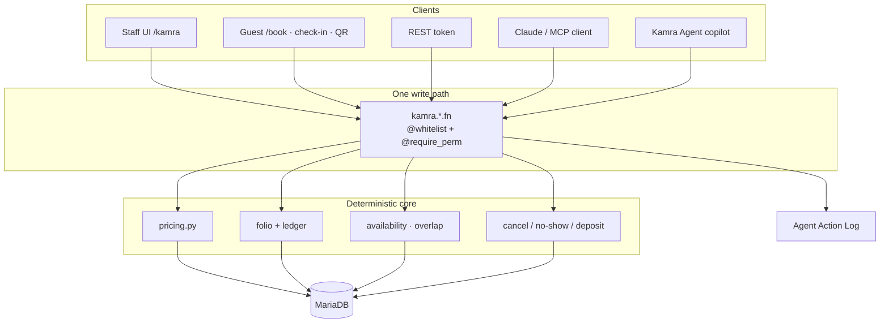
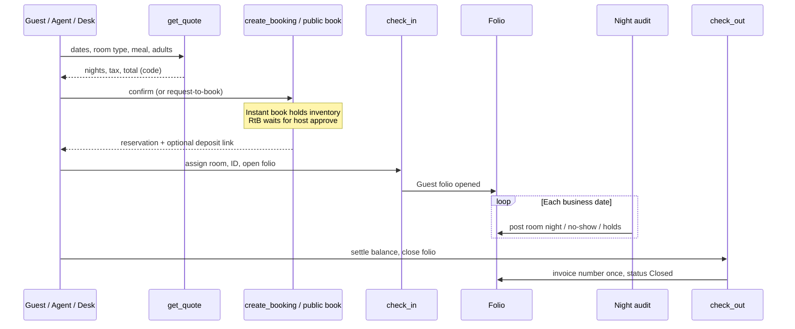
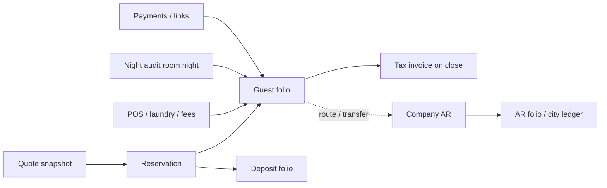
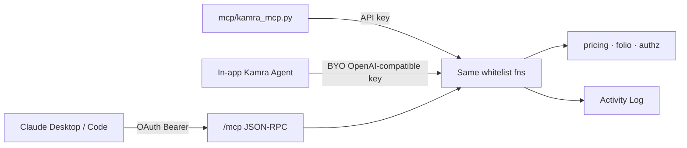

# كيف يعمل Kamra

هذه الصفحة هي خريطة النظام: ما مكوناته، وكيف تمر الإقامة عبرها، وأين تُحسب
الأموال، وكيف يتشارك البشر وعملاء REST ووكلاء الذكاء الاصطناعي مسار كتابة
واحدا.

**ما الذي يميّزه:** Kamra مبني للوكلاء من الأساس. يستدعي Claude (أو أي عميل
MCP) الأدوات نفسها المحصورة حسب الدور التي تستخدمها واجهة الموظفين.
الأسعار لا تأتي من النموذج أبدا. هذا ما يميّز المنتج، وبقية هذه الصفحة
توضح كيف تجعل البنية ذلك آمنا. أدلة الوحدات تغطي مهام الفندق اليومية.

**الإصدار المستقر الحالي:**
[v2.6.20](https://github.com/Kamra-PMS/kamra-pms/releases/tag/v2.6.20)
(الفرع `main`). البناءات الليلية تتبع `develop`. ثبّت من
[سوق Frappe Cloud](/self-hosting/frappe-cloud) أو
[استضفه ذاتيا](/self-hosting/).

## القاعدة التي يتبعها كل شيء آخر

يوجد **مسار كتابة واحد**. واجهة الموظفين وREST وخادم MCP المستضاف ووكيل
Kamra داخل التطبيق تستدعي كلها دوال `@frappe.whitelist` نفسها. الأسعار
وضريبة GST/VAT والتوفر ورسوم الإلغاء هي **كود**
(`kamra/pricing.py`، ودفتر الفاتورة، والتدقيق الليلي). النموذج اللغوي لا
يخترع سعرا أبدا. إذا لم يكن الدور كافيا أو كان الرقم خارج الحدود، ترفض
الدالة الطلب.

لا تضف كاتبا ثانيا (SQL مباشر يتجاوز API، أو مبلغ يثق به العميل على نقطة
نهاية عامة، أو أداة MCP تحسب سعرها بنفسها).

## البنية بنظرة سريعة

| الطبقة | ما هي |
| --- | --- |
| واجهة الموظفين | تطبيق React SPA على `/kamra` (و`/hk` للتدبير المنزلي) |
| واجهات الضيوف | `/book`، و`/stay/:slug`، وتسجيل الوصول الذاتي |
| API | دوال Frappe المسموح بها: `POST /api/method/kamra.<module>.<fn>` |
| الوكلاء | MCP مستضاف على `/mcp` (OAuth) أو مكوّن stdio جانبي `mcp/kamra_mcp.py` |
| المال | محرك التسعير، ودفتر الفاتورة، وأمين الصندوق، والتدقيق الليلي |
| البيانات | MariaDB عبر Frappe DocTypes، ورسوم الفاتورة تُضاف ولا تُعدَّل |
| اختياري | `payments` (مطلوب)، وERPNext / Frappe HR على الموقع نفسه |

## واجهات المنتج

| الرابط | لمن | الغرض |
| --- | --- | --- |
| `/kamra` | الموظفون | نظام إدارة الفندق كاملا (اليوم، مخطط الغرف، الفاتورة، نقطة البيع، الإعدادات، …) |
| `/kamra/hk` | التدبير المنزلي | لوحة غرف ومهام مناسبة للهاتف |
| `/kamra/setup` | المسؤول | معالج إعداد العقار عند أول تشغيل |
| `/book` | الضيوف | الحجز المباشر / كتالوج الفلل |
| `/stay/:slug` | الضيوف | موقع لوحدة واحدة أو لعدة وحدات |
| `/app` | تقنية المعلومات | Frappe Desk (مخرج طوارئ، وليس واجهة الفندق) |
| `/mcp` | الوكلاء | MCP عبر Streamable HTTP (OAuth 2.1) |

ملفات واجهة SPA للإنتاج **مبنية مسبقا** في `kamra/public/frontend`.
تثبيتات السوق وDocker لا تشغّل `npm` على الخادم.

## دورة حياة الإقامة

1. **عرض سعر**: تحسب `get_quote` سعر كل ليلة من خطط الأسعار، والمواسم،
   وخطط الوجبات، والقسائم، والحيوانات الأليفة، ورسوم التنظيف، وحزمة ضرائب
   الدولة.
2. **احجز**: `create_booking` من واجهة الموظفين أو `public_api.book` من
   الواجهة العامة. الحجز الفوري يحفظ نسخة من سياسة الدفع، وطلب الحجز لا
   يحجز المخزون حتى يتم تأكيده.
3. **قبل الوصول**: عربون اختياري، ورابط تسجيل الوصول الذاتي، وقوالب
   WhatsApp، والتقاط الهوية.
4. **تسجيل الوصول**: تخصيص الغرفة، وبطاقة التسجيل، وفتح الفاتورة.
5. **داخل الفندق**: ترحيل نقطة البيع إلى الغرفة، والغسيل، والتذاكر، وتغيير
   الغرفة، ورسوم الوصول المبكر / المغادرة المتأخرة كسياسات مكتوبة في الكود.
6. **تدقيق الليل**: نهاية اليوم (معالج يدوي أو جدولة الساعة 03:00): ترحيل
   ليالي الغرف، وعدم الحضور، وحجوزات الوصول المتأخر المؤقتة، وتقديم تاريخ
   العمل، وحفظ حزمة التدقيق.
7. **تسجيل المغادرة**: تسوية كل فاتورة (أو قواعد التسوية الجزئية)، وإغلاق
   الفاتورة، وتخصيص رقم الفاتورة الضريبية مرة واحدة.

## الوحدات (ما يشغّله الفندق)

وحدات العقار (`enabled_modules`، والقيمة الفارغة تعني الكل) تتحكم في ظهور
الواجهة وأدوات MCP معا:

| الوحدة | ما تغطيه | دليل الموظفين |
| --- | --- | --- |
| الاستقبال | اليوم، وتسجيل الوصول والمغادرة، ومخطط الغرف، والحجز المباشر، وبطاقة التسجيل | [مكتب الاستقبال](/ar/front-desk) |
| الحجوزات | الحجوزات، والمجموعات، والحجب، وقائمة الانتظار، والحجوزات المركزية | [الحجوزات](/ar/reservations) |
| الفوترة | الفواتير، والمدفوعات، والذمم المدينة، وأمين الصندوق، والفواتير الضريبية | [الفوترة](/ar/billing) |
| تدقيق الليل | نهاية اليوم، وتاريخ العمل، وعدم الحضور | [التدقيق الليلي](/ar/night-audit) |
| التدبير المنزلي | لوحة الغرف، وتطبيق `/hk`، والغسيل، والمفقودات | [التدبير المنزلي](/ar/housekeeping) |
| العمليات | طلبات الضيوف / تذاكر مستوى الخدمة | [طلبات النزلاء](/ar/operations) |
| المأكولات والمشروبات | نقطة البيع، وأمر المطبخ، وشاشة المطبخ | [المأكولات والمشروبات](/ar/fnb) |
| الفعاليات | المآدب من الاستفسار حتى أمر الفعالية (BEO) | [المآدب](/ar/banquets) |
| الإيرادات | الأسعار، والمواسم، وأسعار الطلب، والقسائم | [الإيرادات](/ar/revenue) |
| محرك الحجز | `/book`، وكتالوج الفلل، والسياسات | [محرك الحجز](/ar/booking-engine) |
| المراسلة | WhatsApp على رقم Meta الخاص بك | [WhatsApp](/whatsapp) |
| القنوات | مزامنة OTA / مدير القنوات | [مدير القنوات](/channel-manager) |
| المالية / الإدارة | التقارير، والإعدادات، والمطورون، وصحة النظام | [التقارير](/ar/reports)، [الإعدادات](/ar/settings) |

حزم ضرائب الدول، والخصوصية (DPDP)، وربط الذكاء الاصطناعي موجودة في
[إعداد الدولة](/country-setup) و[الميزات](/ar/features) و
[اربط ذكاءك الاصطناعي](/ai-and-mcp).

## المال والدفاتر

قواعد صارمة يفرضها الكود:

- **الرسوم تُضاف ولا تُعدَّل.** الإبطال سطر عكسي مع سبب، وليس تعديلا في
  مكان السطر.
- **الإغلاق يحتاج رصيدا صفريا** (أو مسار تسوية جزئية صريحا).
- **حدود الأسعار**: لا يستطيع `set_room_rate` الخروج عن الحد الأدنى /
  الأعلى الذي يحدده المالك، وأسعار الطلب تضيف حدودا دنيا حسب الطلب.
- **الكحول لا يُحمَّل أبدا على فاتورة شركة** عند الترحيل إلى الغرفة من
  نقطة البيع.
- **الإلغاء / عدم الحضور**: الرسوم تأتي من نقاط نهاية معاينة السياسة،
  والإعفاء منها يُسجَّل.
- **أمين الصندوق**: جلسة مفتوحة، ورمز PIN اختياري للبشر، والوكلاء لا
  يحتاجون PIN لكنهم يبقون في سجل النشاط.
- **حزمة التوطين** تحدد تقسيم الضريبة، والمبالغ بالحروف، وتسميات الفاتورة.
  شرائح GST في الهند تُحسب لكل ليلة حسب السعر.

## الدخول والأدوار ونطاق العقار

الأدوار (أمثلة): Front Desk، وRevenue Manager، وFinance، وHousekeeping،
وHotel Admin، وSystem Manager، وKamra Agent، وNight Auditor، وF&B Manager.

القيود موجودة على نقطة النهاية (`@require_perm`، صلاحيات Frappe في Role Permission Manager)، وليس
على DocPerms فقط. التثبيتات متعددة العقارات تستخدم Property User
Permissions مع hooks خاصة بـ Kamra، حتى لا يستطيع مستخدم مقيّد قراءة
حجوزات عقار آخر أو فواتيره أو بيانات ضيوفه الشخصية، أو الكتابة فوقها، عبر
Desk أو REST.

## مكان الذكاء الاصطناعي

- **116 أداة خاضعة للصلاحيات** على develop (راجع [أدوات MCP](/mcp-tools))،
  والإصدار المستقر `main` ينشر العدد الخاص بذلك الوسم.
- تُصفّى الأدوات حسب **الدور ∩ دور MCP ∩ الوحدات المفعّلة ∩ مفاتيح الذكاء
  الاصطناعي في العقار** (راجع [من يمكنه استخدام MCP](/ai-and-mcp#who-can-use-mcp)).
- الأدوات التي تغيّر البيانات تضبط `frappe.flags.kamra_agent_call` وتسجّل
  `mcp_<name>`.
- واجهة الربط: **وكيل كامرا → اربط ذكاءك الاصطناعي**. يلزم رابط HTTPS
  عام لميزة ربط Claude.

## ملخص التكاملات

| التكامل | المسار |
| --- | --- |
| المدفوعات / الروابط | تطبيق `payments` مع حزم Razorpay / Cashfree للهند |
| WhatsApp | Meta Cloud API على رقمك، [الدليل](/whatsapp) |
| مدير القنوات | دفع ARI / webhooks، [الدليل](/channel-manager) |
| Webhooks صادرة | أحداث صادرة موقّعة (الحجوزات، والتدقيق الليلي، …) |
| ERPNext / HR | تطبيقات اختيارية على الموقع نفسه، [الدليل](/self-hosting/erpnext-hr) |
| تصدير المحاسبة | ملف CSV لـ Tally / Zoho / ERPNext من التقارير |

## المجدول (المهام المدمجة)

من `hooks.py` (المعتاد):

- كل ساعة: دفع ARI / القنوات حيث تم الإعداد
- **03:00** التدقيق الليلي (حسب إعدادات كل عقار)
- **09:00** روابط ما قبل الوصول
- كل **15 دقيقة** تصعيد مهام التدبير المنزلي وانتهاء الحجوزات المؤقتة
- **08:30** تذكيرات المآدب
- **04:15** إعادة ضبط العرض التجريبي (فقط عند `kamra_demo_mode`)

## خريطة المستودع (للمساهمين)

| المسار | الدور |
| --- | --- |
| `kamra/api.py` | جوهر واجهة الموظفين: عرض السعر، والحجز، وتسجيل الوصول والمغادرة، والتدبير المنزلي، والتذاكر |
| `kamra/pricing.py` | الأسعار والضرائب المحسوبة بالكود |
| `kamra/folio.py` / `ledger.py` / `cashier.py` | المال |
| `kamra/pos.py` / `laundry.py` / `banquet*.py` | المأكولات والمشروبات والفعاليات |
| `kamra/mcp_tools.py` / `mcp_http.py` / `mcp_oauth.py` | MCP |
| `kamra/public_api.py` | نقاط نهاية allow_guest للضيوف (بحد لمعدل الطلبات) |
| `kamra/authz.py` | الأدوار ونطاق العقار |
| `kamra/localization/` | حزم الدول |
| `frontend/src/` | تطبيق React SPA |
| `docs-site/` | هذه الوثائق (VitePress) |

## إلى أين بعد ذلك

- [الميزات بنظرة سريعة](/ar/features): كل وحدة مع لقطات شاشة
- [الجديد](/releases): الإصدارات المستقرة الحالية والأخيرة
- [أدلة حسب الدور](/ar/user-guide): المهام اليومية
- [اربط ذكاءك الاصطناعي](/ai-and-mcp): Claude و MCP
- [REST API](/api) و[مرجع API](/api-reference)
- [الاستضافة الذاتية](/self-hosting/) أو [Frappe Cloud](/self-hosting/frappe-cloud)
