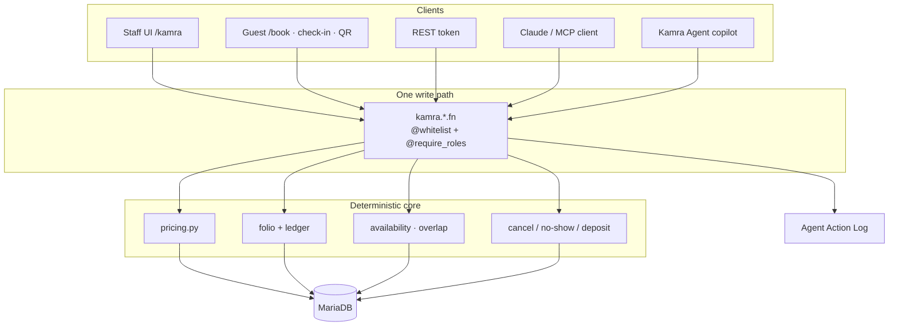
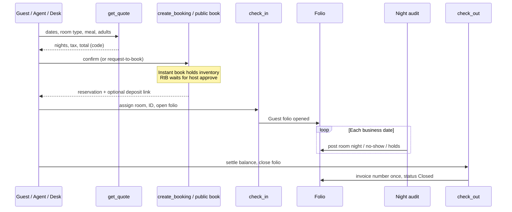
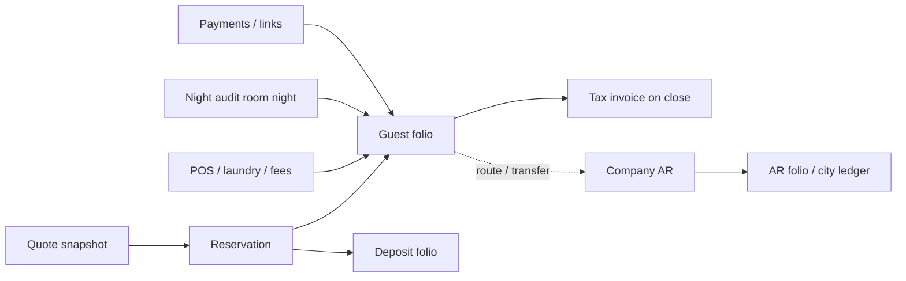
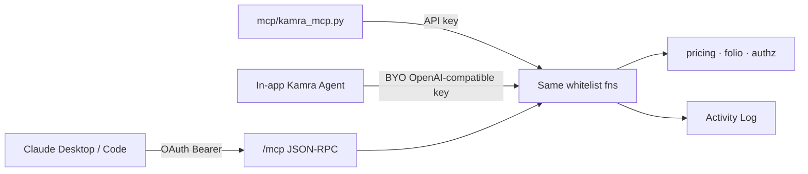

# Cómo funciona Kamra

Esta página es el mapa del sistema: qué piezas hay, cómo pasa una estancia
por ellas, dónde se decide el dinero y cómo las personas, los clientes REST
y los agentes de IA comparten una única vía de escritura.

**Qué lo hace único:** Kamra es nativo para agentes. Claude (o cualquier
cliente MCP) llama a las mismas herramientas limitadas por rol que la
recepción. Los precios nunca salen del modelo. Esa es la ventaja del
producto; el resto de esta página muestra cómo el sistema lo hace seguro.
Las guías de cada módulo explican las tareas diarias del hotel.

**Versión estable actual:**
[v2.6.20](https://github.com/Kamra-PMS/kamra-pms/releases/tag/v2.6.20)
(rama `main`). Las compilaciones nocturnas siguen `develop`. Instale desde
[Frappe Cloud Marketplace](/self-hosting/frappe-cloud) o
[en su propio servidor](/self-hosting/).

## La regla que sigue todo lo demás

Hay **una sola vía de escritura**. La interfaz de recepción, REST, el
servidor MCP alojado y el Agente Kamra integrado llaman a las mismas
funciones `@frappe.whitelist`. Los precios, el GST/IVA, la disponibilidad
y los cargos por cancelación son **código** (`kamra/pricing.py`, libro del
folio, auditoría nocturna). Un modelo de lenguaje nunca inventa una tarifa.
Si falta un rol o un número está fuera de los límites, la función se niega.

No añada un segundo escritor (SQL directo que se salta la API, un importe
en el que se confía porque lo envía el cliente en un endpoint público, una
herramienta MCP que calcula su propio precio).

## El sistema de un vistazo

| Capa | Qué es |
| --- | --- |
| Interfaz del personal | SPA de React en `/kamra` (y `/hk` para limpieza) |
| Superficies para huéspedes | `/book`, `/stay/:slug`, registro de entrada en línea |
| API | Métodos de Frappe en lista permitida: `POST /api/method/kamra.<module>.<fn>` |
| Agentes | MCP alojado en `/mcp` (OAuth) o proceso auxiliar stdio `mcp/kamra_mcp.py` |
| Dinero | Motor de precios, libro del folio, cajero, auditoría nocturna |
| Datos | MariaDB mediante DocTypes de Frappe; cargos del folio solo por adición |
| Opcional | `payments` (obligatoria), ERPNext / Frappe HR en el mismo sitio |

## Superficies del producto

| URL | Quién | Para qué |
| --- | --- | --- |
| `/kamra` | Personal | PMS completo (Hoy, calendario, folio, punto de venta, configuración, …) |
| `/kamra/hk` | Limpieza | Panel de habitaciones y tareas, pensado para el móvil |
| `/kamra/setup` | Administración | Asistente de configuración inicial del alojamiento |
| `/book` | Huéspedes | Reserva directa / catálogo de villas |
| `/stay/:slug` | Huéspedes | Sitio de un anuncio o de varios anuncios |
| `/app` | TI | Frappe Desk (vía de escape; no es la interfaz del producto hotelero) |
| `/mcp` | Agentes | MCP por HTTP con streaming (OAuth 2.1) |

Los recursos de la SPA de producción vienen **precompilados** en
`kamra/public/frontend`. Las instalaciones desde Marketplace y Docker no
ejecutan `npm` en el servidor.

## Ciclo de la estancia

1. **Cotización**: `get_quote` calcula el precio de cada noche a partir de
   los planes de tarifas, las temporadas, los regímenes de comidas, los
   vales, las mascotas, los cargos de limpieza y el paquete fiscal del país.
2. **Reserva**: `create_booking` desde recepción o `public_api.book` desde
   la web pública. La reserva inmediata guarda la política de pago; la
   solicitud de reserva no retiene inventario hasta que se confirma.
3. **Antes de la llegada**: depósito opcional, enlace de registro de entrada
   en línea, plantillas de WhatsApp, captura del documento de identidad.
4. **Registro de entrada**: asignación de habitación, ficha de registro,
   apertura del folio.
5. **Alojados**: cargos a la habitación desde el punto de venta, lavandería,
   solicitudes, cambio de habitación, cargos por llegada anticipada o salida
   tardía como políticas en el código.
6. **Auditoría nocturna**: Cierre del día (asistente manual o programado a
   las 03:00): registra las noches de habitación, las no presentaciones y
   las retenciones por llegada tardía, avanza la fecha operativa y guarda
   el paquete de auditoría.
7. **Salida**: todas las cuentas liquidadas (o reglas de liquidación
   parcial), el folio se cierra y el número de factura se asigna una sola
   vez.

## Módulos (lo que gestiona el hotel)

Los módulos del alojamiento (`enabled_modules`, vacío = todos) controlan
tanto la interfaz como las herramientas MCP visibles:

| Módulo | Qué cubre | Guía para el personal |
| --- | --- | --- |
| Recepción | Hoy, entrada/salida, calendario, sin reserva previa, ficha de registro | [Recepción](/es/front-desk) |
| Reservas | Reservas, grupos, bloqueos, lista de espera, central de reservas | [Reservas](/es/reservations) |
| Facturación | Folios, pagos, cuentas por cobrar, cajero, facturas | [Facturación](/es/billing) |
| Auditoría nocturna | Cierre del día, fecha operativa, no presentación | [Auditoría nocturna](/es/night-audit) |
| Limpieza | Panel de habitaciones, aplicación `/hk`, lavandería, objetos perdidos | [Limpieza](/es/housekeeping) |
| Operaciones | Solicitudes de huéspedes / solicitudes con SLA | [Solicitudes de huéspedes](/es/operations) |
| Alimentos y bebidas | Punto de venta, comandas (KOT), pantalla de cocina | [Alimentos y bebidas](/es/fnb) |
| Eventos | Banquetes desde la consulta hasta la orden de evento (BEO) | [Banquetes](/es/banquets) |
| Ingresos | Tarifas, temporadas, tarifas mínimas por demanda, vales | [Ingresos](/es/revenue) |
| Motor de reservas | `/book`, catálogo de villas, políticas | [Motor de reservas](/es/booking-engine) |
| Mensajería | WhatsApp en su número de Meta | [WhatsApp](/whatsapp) |
| Canales | Sincronización con OTA / channel manager | [Channel manager](/channel-manager) |
| Finanzas / administración | Informes, configuración, desarrolladores, estado | [Informes](/es/reports), [Configuración](/es/settings) |

Los paquetes fiscales por país, la privacidad (DPDP) y la conexión de IA
están en [Configuración por país](/country-setup),
[Funciones](/es/features) y [Conecte su IA](/ai-and-mcp).

## Dinero y libros contables

Reglas estrictas aplicadas en el código:

- **Cargos solo por adición.** Las anulaciones son líneas de reversión con
  un motivo, no ediciones sobre la línea original.
- **Para cerrar hace falta saldo cero** (o una vía explícita de liquidación
  parcial).
- **Límites de tarifas**: `set_room_rate` no puede salirse del mínimo /
  máximo del propietario; las tarifas mínimas por demanda añaden mínimos
  según la demanda.
- **El alcohol nunca se factura a un folio de empresa** al cargar a la
  habitación desde el punto de venta.
- **Cancelación / no presentación**: los cargos salen de los endpoints de
  vista previa de la política; la condonación queda registrada.
- **Cajero**: sesión abierta; PIN opcional para personas; los agentes no
  usan PIN pero quedan en el registro de actividad.
- **Paquete de localización**: elige el desglose de impuestos, los importes
  en letras y las etiquetas de la factura. Los tramos de GST de la India
  van por noche según la tarifa.

## Autenticación, roles y alcance por alojamiento

Roles (ejemplos): Recepción, Responsable de ingresos, Finanzas, Limpieza,
Administrador del hotel, Administrador del sistema, Agente Kamra, Auditor
nocturno.

Los controles están en el endpoint (`@require_roles` / `_kamra_roles`), no
solo en los DocPerms. Las instalaciones con varios alojamientos usan
Property User Permissions y hooks de Kamra para que un usuario restringido
no pueda leer ni sobrescribir las reservas, los folios ni los datos
personales de huéspedes de otro alojamiento a través de Desk o REST.

## Cómo encaja la IA

- **116 herramientas controladas** en develop (consulte
  [Herramientas MCP](/mcp-tools)); la rama estable `main` publica el número
  para esa etiqueta.
- Las herramientas se filtran por **rol ∩ rol MCP ∩ módulos activados ∩
  interruptores de IA del alojamiento** (consulte
  [Who can use MCP](/ai-and-mcp#who-can-use-mcp)).
- Las herramientas que modifican datos activan
  `frappe.flags.kamra_agent_call` y registran `mcp_<name>`.
- Interfaz de conexión: **Agente Kamra → Conecte su IA**. Conectar Claude
  requiere HTTPS público.

## Resumen de integraciones

| Integración | Vía |
| --- | --- |
| Pagos / enlaces | Aplicación `payments` + paquetes Razorpay / Cashfree para la India |
| WhatsApp | Meta Cloud API en su número: [guía](/whatsapp) |
| Channel manager | Envío de ARI / webhooks: [guía](/channel-manager) |
| Webhooks salientes | Eventos salientes firmados (reservas, auditoría nocturna, …) |
| ERPNext / RR. HH. | Aplicaciones opcionales en el mismo sitio: [guía](/self-hosting/erpnext-hr) |
| Exportación contable | CSV para Tally / Zoho / ERPNext desde Informes |

## Programador (tareas integradas)

De `hooks.py` (lo habitual):

- Envío de ARI / canales cada hora donde esté configurado
- Auditoría nocturna a las **03:00** (según la configuración del
  alojamiento)
- Enlaces previos a la llegada a las **09:00**
- Cada **15 min**, escalado de limpieza y caducidad de retenciones
- Recordatorios de banquetes a las **08:30**
- Restablecimiento de la demo a las **04:15** (solo con `kamra_demo_mode`)

## Mapa del repositorio (para colaboradores)

| Ruta | Función |
| --- | --- |
| `kamra/api.py` | Núcleo de recepción: cotización, reserva, entrada/salida, limpieza, solicitudes |
| `kamra/pricing.py` | Tarifas e impuestos deterministas |
| `kamra/folio.py` / `ledger.py` / `cashier.py` | Dinero |
| `kamra/pos.py` / `laundry.py` / `banquet*.py` | Alimentos y bebidas y eventos |
| `kamra/mcp_tools.py` / `mcp_http.py` / `mcp_oauth.py` | MCP |
| `kamra/public_api.py` | Endpoints allow_guest para huéspedes (con límite de peticiones) |
| `kamra/authz.py` | Roles y alcance por alojamiento |
| `kamra/localization/` | Paquetes por país |
| `frontend/src/` | SPA de React |
| `docs-site/` | Esta documentación (VitePress) |

## Siguientes pasos

- [Funciones de un vistazo](/es/features): cada módulo con capturas
- [Novedades](/releases): versiones estables actuales y recientes
- [Guías por rol](/es/user-guide): tareas diarias
- [Conecte su IA](/ai-and-mcp): Claude y MCP
- [API REST](/api) y [referencia de la API](/api-reference)
- [Instalación en su servidor](/self-hosting/) o [Frappe Cloud](/self-hosting/frappe-cloud)
