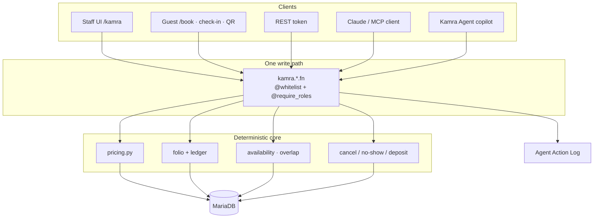
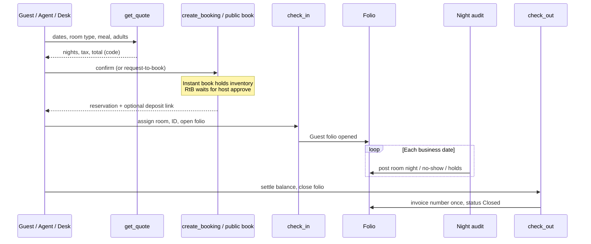
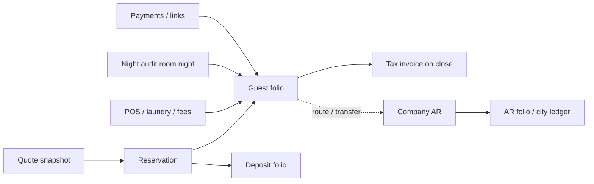
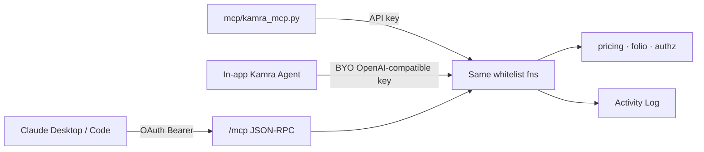

# How Kamra works

This page is the system map: what the pieces are, how a stay moves through
them, where money is decided, and how humans, REST clients and AI agents
share one write path.

**What is unique:** Kamra is agent-native. Claude (or any MCP client)
calls the same role-scoped tools as the desk. Prices never come from the
model. That is the product edge - the rest of this page shows how the
stack makes it safe. Module guides cover day-to-day hotel tasks.

**Current stable release:**
[v2.6.16](https://github.com/Kamra-PMS/kamra-pms/releases/tag/v2.6.16)
(branch `main`). Nightly builds track `develop`. Install from the
[Frappe Cloud Marketplace](/self-hosting/frappe-cloud) or
[self-host](/self-hosting/).

## The rule everything else follows

There is **one write path**. The desk UI, REST, the hosted MCP server and
the in-app Kamra Agent all call the same `@frappe.whitelist` functions.
Prices, GST/VAT, availability and cancellation fees are **code**
(`kamra/pricing.py`, folio ledger, night audit). A language model never
invents a rate. If a role is short or a number is outside guardrails, the
function refuses.

Do not add a second writer (raw SQL that skips the API, a client-trusted
amount on a public endpoint, an MCP tool that computes its own price).

## Stack at a glance

| Layer | What it is |
| --- | --- |
| Staff UI | React SPA at `/kamra` (and `/hk` for housekeeping) |
| Guest surfaces | `/book`, `/stay/:slug`, self check-in |
| API | Frappe whitelisted methods: `POST /api/method/kamra.<module>.<fn>` |
| Agents | Hosted MCP at `/mcp` (OAuth) or stdio sidecar `mcp/kamra_mcp.py` |
| Money | Pricing engine, folio ledger, cashier, night audit |
| Data | MariaDB via Frappe DocTypes; append-only folio charges |
| Optional | `payments` (required), ERPNext / Frappe HR on the same site |

## Product surfaces

| URL | Who | Purpose |
| --- | --- | --- |
| `/kamra` | Staff | Full PMS (Today, tape, folio, POS, settings, …) |
| `/kamra/hk` | Housekeeping | Phone-friendly room board and tasks |
| `/kamra/setup` | Admin | First-run property wizard |
| `/book` | Guests | Direct booking / villa catalogue |
| `/stay/:slug` | Guests | One listing or multi-listing site |
| `/app` | IT | Frappe Desk (escape hatch; not the hotel product UI) |
| `/mcp` | Agents | Streamable HTTP MCP (OAuth 2.1) |

Production SPA assets are **prebuilt** under `kamra/public/frontend`.
Marketplace and Docker installs do not run `npm` on the server.

## Stay lifecycle

1. **Quote** - `get_quote` prices every night from rate plans, seasons,
   meal plans, vouchers, pets, cleaning fees and the country tax pack.
2. **Book** - desk `create_booking` or public `public_api.book`. Instant
   book snapshots the payment policy; request-to-book does not hold
   inventory until confirmed.
3. **Pre-arrival** - optional deposit, self check-in link, WhatsApp
   templates, ID capture.
4. **Check-in** - room assignment, registration card, folio opens.
5. **In-house** - POS room posting, laundry, tickets, room change, early
   / late fees as coded policies.
6. **Night audit** - End of Day (manual wizard or 03:00 schedule): post
   room nights, no-shows, late-arrival holds, advance the business date,
   save the audit pack.
7. **Check-out** - every bill settled (or part-settle rules), folio
   closes, invoice number assigned once.

## Modules (what the hotel runs)

Property modules (`enabled_modules`, empty = all) gate both the UI and
MCP tool visibility:

| Module | What it covers | Staff guide |
| --- | --- | --- |
| Front desk | Today, check-in/out, tape, walk-in, GRC | [Front desk](/front-desk) |
| Reservations | Bookings, groups, blocks, waitlist, CRS | [Reservations](/reservations) |
| Billing | Folios, payments, AR, cashier, invoices | [Billing](/billing) |
| Night audit | End of Day, business date, no-show | [Night audit](/night-audit) |
| Housekeeping | Room board, `/hk` app, laundry, L&F | [Housekeeping](/housekeeping) |
| Operations | Guest requests / SLA tickets | [Guest requests](/operations) |
| F&B | POS, KOT, kitchen display | [F&B](/fnb) |
| Events | Banquets from enquiry to BEO | [Banquets](/banquets) |
| Revenue | Rates, seasons, hurdles, vouchers | [Revenue](/revenue) |
| Booking engine | `/book`, villa catalogue, policies | [Booking engine](/booking-engine) |
| Messaging | WhatsApp on your Meta number | [WhatsApp](/whatsapp) |
| Channels | OTA / channel manager sync | [Channel manager](/channel-manager) |
| Finance / admin | Reports, settings, developers, health | [Reports](/reports), [Settings](/settings) |

Country tax packs, privacy (DPDP) and AI connect live under
[Country setup](/country-setup), [Features](/features) and
[Connect your AI](/ai-and-mcp).

## Money and ledgers

Hard rules enforced in code:

- **Append-only charges.** Voids are reversing lines with a reason, not
  edits in place.
- **Close needs zero balance** (or an explicit part-settle path).
- **Rate guardrails** - `set_room_rate` cannot leave the owner's floor /
  ceiling; hurdle rates add demand floors.
- **Alcohol never bills a Company folio** when room-posting from POS.
- **Cancellation / no-show** fees come from policy preview endpoints;
  waive is logged.
- **Cashier** - open session; optional PIN for humans; agents skip PIN
  but stay on the activity log.
- **Localization pack** picks tax split, currency words and invoice
  labels. India GST slabs are per night from the tariff.

## Auth, roles and property scope

Roles (examples): Front Desk, Revenue Manager, Finance, Housekeeping,
Hotel Admin, System Manager, Kamra Agent, Night Auditor.

Gates live on the endpoint (`@require_roles` / `_kamra_roles`), not only
on DocPerms. Multi-property installs use Property User Permissions plus
Kamra hooks so a restricted user cannot read or overwrite another
property's reservations, folios or guest PII through Desk or REST.

## How AI fits in

- **101 governed tools** on develop (see [MCP tools](/mcp-tools)); stable
  `main` publishes the count for that tag.
- Tools are filtered by **role ∩ enabled modules**.
- Mutating tools set `frappe.flags.kamra_agent_call` and log
  `mcp_<name>`.
- Connect UI: **Kamra Agent → Connect your AI**. Public HTTPS is
  required for Connect Claude.

## Integrations outline

| Integration | Path |
| --- | --- |
| Payments / links | `payments` app + India Razorpay / Cashfree packs |
| WhatsApp | Meta Cloud API on your number - [guide](/whatsapp) |
| Channel manager | ARI push / webhooks - [guide](/channel-manager) |
| Webhooks out | Signed outbound events (bookings, night audit, …) |
| ERPNext / HR | Optional same-site apps - [guide](/self-hosting/erpnext-hr) |
| Accounting export | Tally / Zoho / ERPNext CSV from Reports |

## Scheduler (built-in jobs)

From `hooks.py` (typical):

- Hourly ARI / channel push where configured
- **03:00** night audit (per property settings)
- **09:00** pre-arrival links
- Every **15 min** housekeeping escalation and hold expiry
- **08:30** banquet reminders
- **04:15** demo reset (only when `kamra_demo_mode`)

## Repo map (for contributors)

| Path | Role |
| --- | --- |
| `kamra/api.py` | Core desk: quote, book, check-in/out, HK, tickets |
| `kamra/pricing.py` | Deterministic rates and tax |
| `kamra/folio.py` / `ledger.py` / `cashier.py` | Money |
| `kamra/pos.py` / `laundry.py` / `banquet*.py` | F&B and events |
| `kamra/mcp_tools.py` / `mcp_http.py` / `mcp_oauth.py` | MCP |
| `kamra/public_api.py` | Guest allow_guest endpoints (rate-limited) |
| `kamra/authz.py` | Roles and property scope |
| `kamra/localization/` | Country packs |
| `frontend/src/` | React SPA |
| `docs-site/` | This documentation (VitePress) |

## Where to go next

- [Features at a glance](/features) - every module with screenshots
- [What's new](/releases) - current and recent stable releases
- [Guides by role](/user-guide) - day-to-day tasks
- [Connect your AI](/ai-and-mcp) - Claude and MCP
- [REST API](/api) and [API reference](/api-reference)
- [Self-hosting](/self-hosting/) or [Frappe Cloud](/self-hosting/frappe-cloud)
